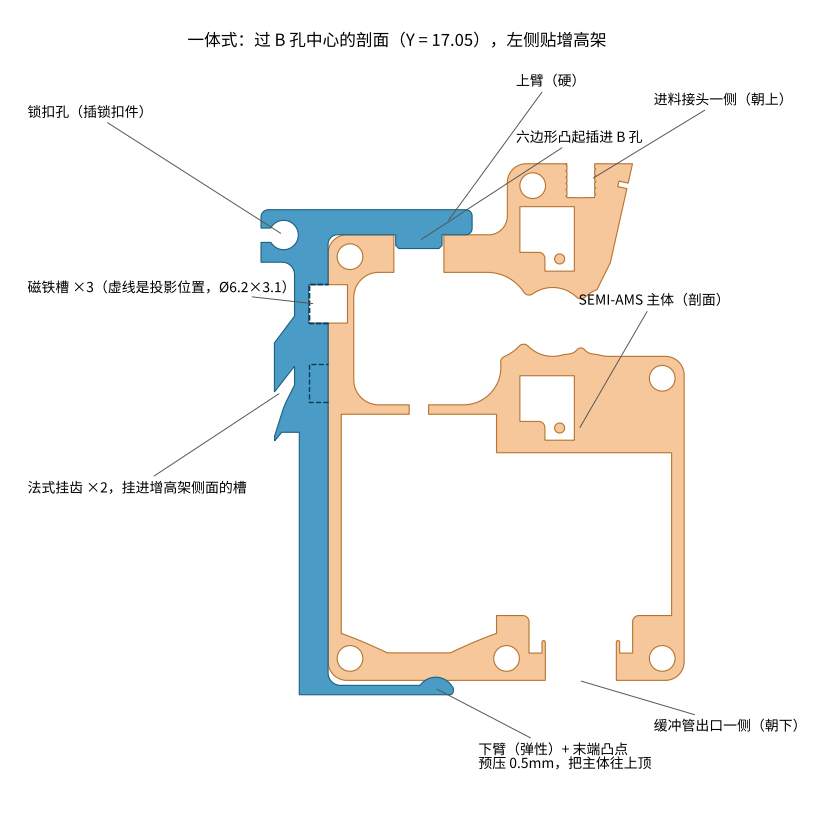
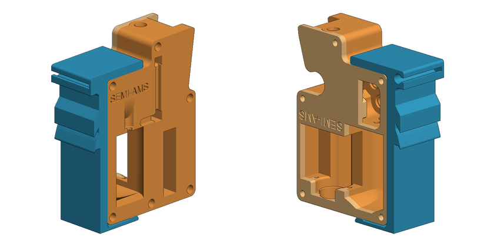
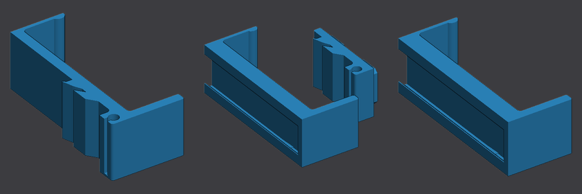
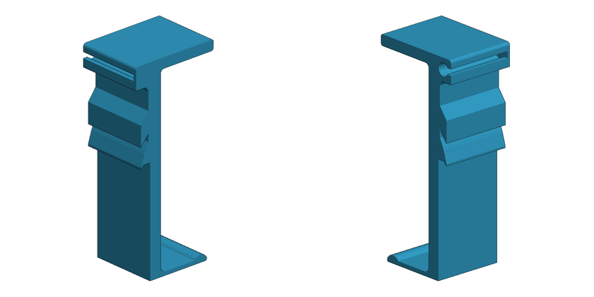
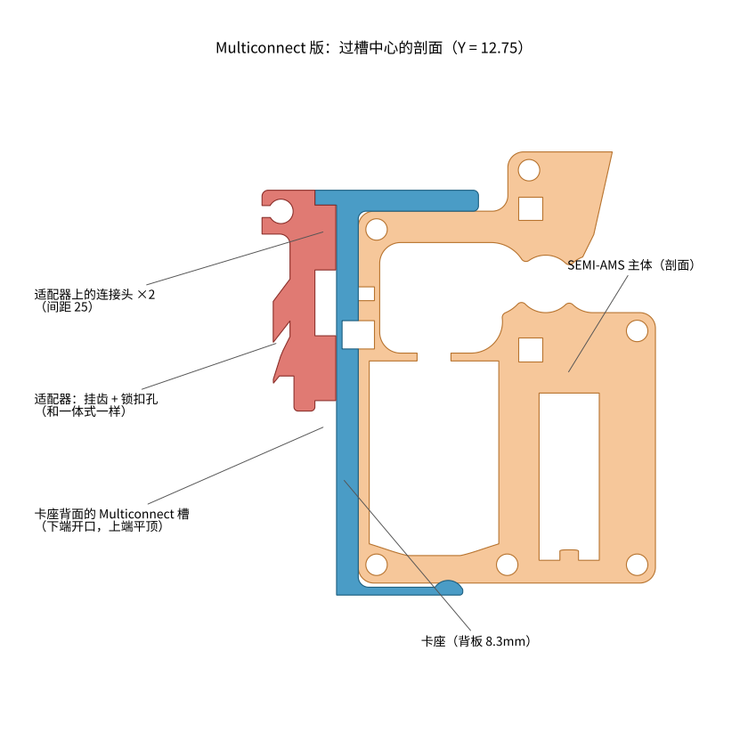
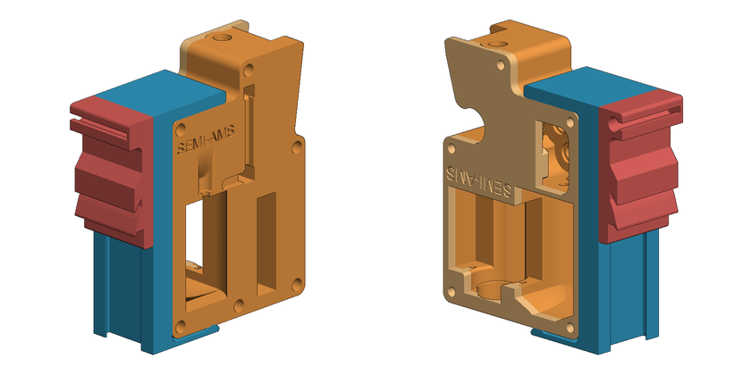
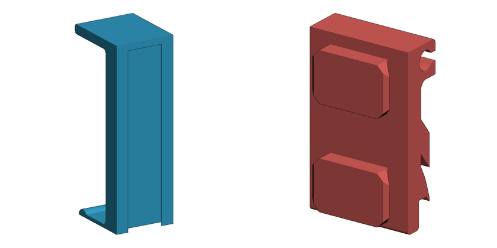

# SEMI-AMS 卡座支架

原厂的固定方式是一块磁吸板（`SEMI-AMS-magnetic-holder.stl`）拧在别处，主体侧面的三颗磁铁吸上去，只靠磁铁，碰一下就歪、就掉。这个支架改成 "[" 形卡座把主体卡住：

- **背板**：贴着主体有磁铁的那一面，对应位置留三个磁铁槽，磁铁照样起作用。
- **上臂**（硬）：下面伸出一个六边形凸起，插进主体顶面的 B 孔（Ø8，调张紧螺丝的那个孔，不走耗材），主体不能前后左右移动。
- **下臂**（有弹性）：长 20mm、厚 1.5mm 的悬臂，末端有一个圆弧凸点，装好后被压下 0.5mm，一直把主体往上顶，凸起就不会从 B 孔里掉出来。装卸时往下压主体，下臂让开，凸起脱出。
- **背后挂载**，有两种做法：
  - **一体式**：背板后面直接是挂 Sanja 3D P2S 增高架侧边导轨的法式挂齿。
  - **Multiconnect 卡座 + 适配器**：背板后面开一条标准 Multiconnect 槽，卡座本身不管挂在哪。挂 Multiboard、Skadis、openGrid、墙面用社区现成的 Multiconnect 连接件；挂 Sanja 增高架用这里的适配器。卡座往上一提就能取下来，换个地方挂。

**安装方向：进料接头（PC4-M6 气动接头）朝上，缓冲管从下面出**（B 孔在上面）。面对打印机侧面看，主体的盖板在右手边。





## 打印板

所有零件都在一个 Bambu Studio 工程 `semi-ams-bracket_with-lock.3mf` 里，分三块打印板，用哪种就只切那一块板（在板上点"切片"，不要点"全部切片"）。第 1、2 块板上带锁扣件：

| 板 | 零件 | 用在哪 |
|---|---|---|
| 1 一体式 · Sanja 增高架 | 一体式支架 + 锁扣件 | 只挂 Sanja 增高架，零件最少、最稳 |
| 2 Multiconnect 卡座 + Sanja 增高架适配器 | 卡座 + 适配器 + 锁扣件 | 挂 Sanja 增高架，卡座以后能拿去挂别处 |
| 3 Multiconnect 卡座 | 卡座 | 配现成连接件挂 Multiboard / Skadis / openGrid / 墙面（见后面） |

打开就是 P2S + PETG + 下面"打印参数"里的设置，不会提示"不是来自 Bambu Lab"。三个 STL 也是打印姿态（侧放）。

- 这个 3MF 里有锁扣件，不进 git（见"一体式"一节），只在本机。从 GitHub 克隆下来没有锁扣件时，`bracket.py` 会生成不带锁扣件的 `semi-ams-bracket.3mf`。
- 3MF 由 `bracket.py` 生成，重新生成会覆盖。在 Bambu Studio 里改的设置要同步改到 `bracket.py` 的 `PRINT_SETTINGS`，不然下次生成就没了。



| 版本 | 状态 |
|---|---|
| 一体式 | 已出图，待试打 |
| Multiconnect 卡座 + Sanja 适配器 | 已出图，待试打 |

## 一体式（Sanja 增高架）



背板后面是两个向下斜的法式挂齿，从导轨上方挂进增高架侧面的槽里；最上面是一个锁扣孔（Ø4.68 圆孔 + 2.29 宽开口，朝增高架方向开口）。挂齿和锁扣孔的尺寸是照 MakerWorld 上 [Multiboard Hanger with Locking French Cleat](https://makerworld.com/en/models/2707930)（2707930）的挂钩实测后重新画的，和原挂钩的剖面逐点重合，所以能用原挂钩的锁扣件：

1. 把支架从上往下挂到增高架侧边导轨上，挂齿落进槽里。
2. 从右侧（盖板那一侧，Y=25.5）把锁扣件插进锁扣孔，尖的一边朝增高架的玻璃。左侧有 1mm 的挡板，插到底就停。
3. 锁扣件用加厚版 `reinforced locking piece even thicker.stl`（放在本目录，和支架一起排在 `_with-lock.3mf` 里）。实测它的圆柱 Ø4.50、颈部 2.23 宽、长 14.6，插进这里 Ø4.68 / 2.29 宽 / 24.5 长的锁扣孔不干涉。
4. 锁扣件和原挂钩都来自 MakerWorld，许可不允许传到别的平台，增高架本身也禁止传播衍生件，所以锁扣件的 STL 和带锁扣件的 3MF 写进了 `.gitignore`，只留在本机；这里的挂齿是自己按尺寸画的，没有用它们的网格。

## Multiconnect 卡座 + 适配器

卡座和一体式的 "[" 形部分完全一样（上臂、凸起、下臂、磁铁槽都不变），只是背板从 4.6mm 加厚到 8.3mm（磁铁槽 3.1 + 中间 1.05 + 槽深 4.15），背面开一条竖直的 Multiconnect v2 槽：

- 槽口宽 15.3、槽底宽 20.3、深 4.15，和所有 Multiconnect 连接件通用。
- **下端开口，上端封死**：卡座从上往下套到连接头上，最上面那个连接头顶到槽顶就到位，主体的重量把它压在那里。
- 槽顶往下 8mm 有 v2 卡点（每边收窄 0.4mm）。连接头装到位后在卡点上方，卡座不会自己往上跳；拔的时候用力往上提，挤过卡点就出来了。不想要卡点就把 `mc_detent` 设成 0（相当于 QuickRelease 槽）。
- 侧放打印，所以槽顶是平的、不是圆的，也没有斜坡入口，不影响用。







### 挂 Sanja 增高架（第 2 块板）

适配器背面和一体式的挂齿、锁扣孔完全一样，正面是两个连接头（间距 25mm）。连接头按标准尺寸做（头部半宽 10、颈部半宽 7.5、高 4），侧放打印时外形做成八角形，下面不悬空。

1. 把适配器挂到增高架侧边导轨上，插锁扣件（和一体式一样，同一个锁扣件）。
2. 卡座对准适配器，从上往下套，两个连接头依次进槽，上面那个顶到槽顶为止。
3. 主体装进卡座（见"装卸"）。主体可以先装进卡座再一起套上去，也可以反过来。
4. 取下：把卡座（连主体）往上提，过了卡点就能拿开，适配器留在增高架上。

### 挂 Multiboard / Skadis / openGrid / 墙面（第 3 块板）

不需要这里画适配器，打印社区现成的 Multiconnect 连接件就能挂（都在 MakerWorld 上）：

| 挂在哪 | 连接件 | 两个连接件的竖向间距 |
|---|---|---|
| Multiboard | [平装连接件（1026736）](https://makerworld.com/en/models/1026736) 或 [凸起连接件（790825）](https://makerworld.com/en/models/790825) | 25（同一列相邻的两个大孔） |
| Skadis 洞洞板 | [Skadis 连接件（888450）](https://makerworld.com/en/models/888450) | 40（同一列上下两个孔） |
| openGrid | [openGrid 连接件（1307474）](https://makerworld.com/en/models/1307474) | 按网格选 |
| 墙面 / 木板 | [螺丝固定的连接件（642716）](https://makerworld.com/en/models/642716) | 随意，25 左右 |

自己画别的连接件可以用 [Multiconnect 建模文件（645768）](https://makerworld.com/en/models/645768)。

1. 在同一竖直线上装**两个**连接件。只用一个也能挂，但圆头在槽里能转，卡座会歪；两个就转不了。
2. 卡座从上往下套到连接件上，上面那个顶到槽顶为止。
3. 装主体。取的时候往上提。

`check.py` 用标准 R10 圆头连接头查过：间距 25 和 40 两个都能装进槽里，间距 40 时下面那个连接头离槽下口还有 14.6mm。

## 装卸（主体进出卡座，两种做法都一样）

1. 磁铁：把原磁吸板上的 3 颗 6×3 磁铁拆下来装进支架的磁铁槽，**原来朝主体的那一面仍然朝主体**（极性不能反），压入或点一滴胶。
2. 装：主体进料接头朝上，底面压在下臂末端的凸点上，往下压约 2.5mm，让顶面低过六边形凸起，从前面推进去；B 孔对准凸起后松手，下臂把主体顶上去，凸起进孔，磁铁吸住背板。也可以先斜着把 B 孔套上凸起，再把下端往里推，下臂被压一下后弹回。
3. 取：把主体往下压，凸起脱出 B 孔，再把主体往外拉开。

按 PETG 估算（E≈2GPa，接触点距根部 17.2mm）：装好时下臂往上顶的力约 4N（主体约 1.2N 重），压下脱开凸起要 25N 左右（约 2.5kg），根部应变 2.3%。PLA 刚度高一倍左右，不建议用 PLA 打这个件；一定要用 PLA 的话把 `arm_t` 改成 1.2。

Multiconnect 卡座：压主体的时候往下用力，卡座只会被压得更紧，不会从连接头上脱出来；要取卡座是往上提。

## 打印参数

已经写在 3MF 里，打开就是这套，不用再调。卡座、适配器和一体式用同一套。

**工程预设**（都是 Bambu Studio 自带的系统预设，打开时用本机的预设值）：

| 项目 | 预设 |
|---|---|
| 打印机 | Bambu Lab P2S 0.4 nozzle |
| 耗材 | Bambu PETG HF @BBL P2S 0.4 nozzle（245°C，热床 70°C）。用别的 PETG 就在耗材 1 换成对应预设，零件设置不受影响 |
| 工艺 | 0.20mm Standard @BBL P2S |
| 热床 | 纹理 PEI 板。用光面 PEI 打 PETG 要先涂胶水隔离，不然粘太牢会撕板 |

**零件上的单独设置**（在对象列表里零件下面能看到，换工艺预设也不会丢）：

| 设置 | 值 | 为什么 |
|---|---|---|
| 墙层数 | 5 | 侧放打印时挂齿、上下臂、连接头的受力都在层内，强度主要靠墙。5 圈每边约 2.2mm，一体式背板 4.6、上臂 4、下臂 1.5、挂齿、连接头基本都是实心 |
| 墙生成器 | Arachne | 1.5mm 的下臂和挂齿尖用变线宽填满，不留缝 |
| 稀疏填充 | 40% 螺旋体 | 卡座 8.3mm 的背板、顶部锁扣块和挂齿那一段较厚，会用到填充 |
| 顶 / 底层 | 5 / 5 | 两个大侧面是顶和底 |
| 接缝 | 后方 | 后方 = 支架最下沿那条平边，避开下臂根部受拉的一侧 |
| 裙边 | 仅外侧 3mm，间隙 0.1 | 下臂是 1.5mm 宽、25.5mm 高的薄片，加一圈好撕的裙边；锁扣件不加 |
| 支撑 | 关 | 不需要。朝下的面只有短桥接：磁铁槽横孔顶 3.1mm、Multiconnect 槽顶 1.2~1.6mm、凸起两侧 60° 斜面、连接头 45° 倒角 |

改这些设置：改 `bracket.py` 里的 `PRINT_SETTINGS` 后重新生成；换打印机或耗材预设用 `make_project_settings.py` 重新生成 `bambu_project_settings.json`。

侧放的好处：挂齿、锁扣孔、上下臂、连接头的剖面都在一层里，下臂弯曲方向和层线平行，不会沿层裂开。

## 尺寸依据

从原厂 `SEMI-AMS-main-body.stl` 和 `SEMI-AMS直_stls/obj_2_组合体.stl`（取其中的盖板）实测，装配坐标见 `bracket.py` 开头的说明。

| 项目 | 数值 |
|---|---|
| 主体顶面（B 孔面）到底面 | 71.16 mm |
| 主体厚度 | 25.5 mm（主体 22.5 + 盖板 3.0） |
| B 孔 | Ø8.0，深 6，中心距磁铁面 14.5、距底板外侧 17.05 |
| 磁铁孔 | Ø6.2 × 3 深，三个中心 (Y, Z) = (17.5, 60.12)、(5.0, 60.12)、(11.25, 47.5) |
| 顶面平整范围 | 距磁铁面 2.5 ~ 26 mm（再往外是进料接头那块凸台） |
| 底面平整范围 | 距磁铁面 3 ~ 34.5 mm（再往外是缓冲管出口） |
| 磁铁面边角 | 顶面一侧 R2，底面一侧 R3 |

Multiconnect 槽和连接头按 Multiconnect v2 标准尺寸画（和 [QuackWorks](https://github.com/AndyLevesque/QuackWorks) 的 `multiconnectSlotDesign.scad` 一致，CC BY-NC-SA 4.0），没有用它的网格。

`check.py` 的检查结果（默认参数）：

| 项目 | 结果 |
|---|---|
| 支架和主体、盖板的干涉 | 一体式和卡座都一样：只有下臂凸点的 0.5mm 预压（主体 25.5 mm³ + 盖板 3.4 mm³），其余为 0 |
| 六边形凸起 | 对角 7.4、对边 6.41、高 2.2，在 Ø8.0 的 B 孔里单边留 0.3 |
| 磁铁槽对位 | 三个都在 0.015mm 以内 |
| 上臂 / 下臂 | 上臂伸到 23mm，离进料接头凸台 3mm；下臂伸到 20mm，离缓冲管出口 14mm |
| 卡座槽底到磁铁槽底 | 1.05 mm |
| 卡座 + Sanja 适配器 | 装到位时干涉 0；往上提时连接头挤过卡点（0.05~0.21 mm³，约 10mm 行程），之后为 0 |
| 标准 R10 连接头 | 装到位时只有 v2 卡点的设计过盈（0.52 mm³）；间距 25、40 的第二个连接头都不干涉 |
| 锁扣件 | 插进一体式和适配器的锁扣孔都不干涉 |

## 参数和调整

参数都在 `bracket.py` 的 `DEFAULTS` 里，也可以生成时临时改：`python3 bracket.py --set arm_t=1.3 preload=0.7`。

| 参数 | 默认 | 说明 / 什么时候改 |
|---|---|---|
| `boss_ac` | 7.4 | 六边形对角距离。打出来插不进 B 孔就改小（7.2），晃就改大（7.6） |
| `boss_h` | 2.2 | 凸起高度。改高更不容易脱，但装卸要压得更多 |
| `arm_t` | 1.5 | 下臂厚度。太硬改 1.3，太软改 1.7（力和厚度的三次方成正比） |
| `preload` | 0.5 | 凸点过盈。主体上下晃就加大 |
| `arm_len` | 20 | 下臂长度 |
| `top_len` | 23 | 上臂长度，最多 25（再长会碰到进料接头那块凸台） |
| `mag_d` / `mag_depth` | 6.2 / 3.1 | 磁铁槽，换磁铁时改 |
| `wall` | 4.6 | 一体式背板厚度 |
| `keyhole_stop` | 1.0 | 锁扣孔左侧挡板厚度，设成 0 就两头通 |
| `wall_mc` | 8.3 | 卡座背板厚度（磁铁槽 + 1.05 + 槽深 4.15），一般不用改 |
| `mc_detent` | 1 | 1 = 槽顶有 v2 卡点；0 = 没有卡点，一提就出来 |
| `mc_head` | 10.0 | 适配器连接头半宽（槽 10.15）。打出来太紧插不进就改 9.9 |
| `mc_spacing` | 25 | 适配器上两个连接头的间距 |
| `adapter_t` | 4.0 | 适配器底板厚度 |

## 文件

| 文件 | 内容 |
|---|---|
| `bracket.py` | 参数化生成脚本，输出各零件打印姿态的 STL 和多打印板的 Bambu Studio 工程 3MF；打印设置在 `PRINT_SETTINGS`，打印板在 `PLATES` |
| `bambu3mf.py` | 写 Bambu Studio 工程格式的 3MF（多打印板、缩略图） |
| `bambu_project_settings.json` | 工程预设（P2S + PETG HF + 0.20mm Standard） |
| `make_project_settings.py` | 生成上面这个 json：按 Bambu Studio 02.07.01.57 的工程结构，从 GitHub 上同版本的官方预设展开 |
| `check.py` | 和原厂主体对位检查（干涉、凸起间隙、磁铁对位、连接头和槽、锁扣件、悬空面），并生成 `images/` 里的预览图 |
| `render.py` | 预览图和 3MF 缩略图用的简单渲染 |
| `semi-ams-bracket_with-lock.3mf` | 工程文件，三块打印板，第 1、2 块板带锁扣件（不进 git）。没有锁扣件 STL 时生成的是 `semi-ams-bracket.3mf` |
| `semi-ams-bracket_sanja-riser.stl` | 一体式 |
| `semi-ams-bracket_multiconnect.stl` | Multiconnect 卡座 |
| `semi-ams-adapter_sanja-riser.stl` | Sanja 增高架适配器 |
| `reinforced locking piece even thicker.stl` | 加厚锁扣件（MakerWorld 模型，不进 git） |
| `images/` | 预览图 |

重新生成：

```bash
pip3 install numpy shapely trimesh manifold3d matplotlib pillow
cd 3d-files/bracket
python3 bracket.py                       # 生成所有零件的 STL 和 semi-ams-bracket_with-lock.3mf（自动带上本目录的锁扣件）
python3 bracket.py --assembly            # 另外输出装配姿态的 STL，可以和主体一起导入切片软件看对位
python3 check.py ~/SynologyDrive/3D打印/20260819_semi-ams/SEMI-AMS-main-body.stl \
    "$HOME/SynologyDrive/3D打印/20260819_semi-ams/SEMI-AMS直_stls/obj_2_组合体.stl" \
    --lock "reinforced locking piece even thicker.stl" --png images
```

加新的挂法：

- 优先加**适配器**：在 `bracket.py` 里写一个 `adapter_xxx(P)`（正面用 `mc_head()` 放两个连接头，背面做新场景的固定方式），登记到 `ADAPTERS`，再在 `PLATES` 里加一块板。卡座不用动。
- 真要做一体式：写一个 `mount_xxx(P, geo)`，返回要加的实体和要减的实体（背板背面在 `X = geo["x_back"]`，顶端在 `Z = geo["z_top"]`），登记到 `MOUNTS`。

## 待做

- 试打后确认：凸起和 B 孔的松紧、下臂力度、挂齿在增高架上的贴合、连接头在卡座槽里的松紧和卡点手感。
- 实际挂一次 Multiboard / Skadis，确认现成连接件的配合。
