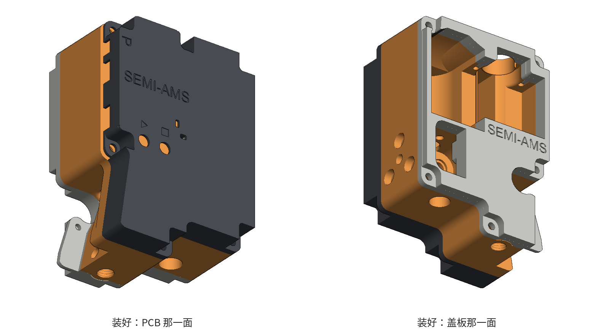
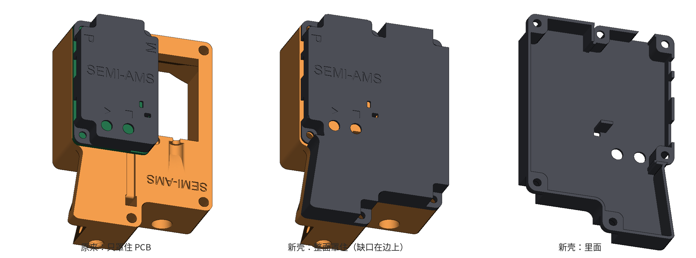
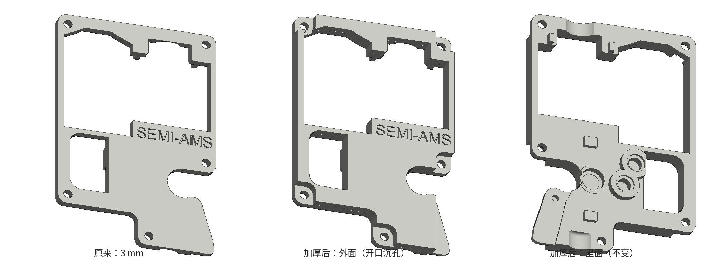
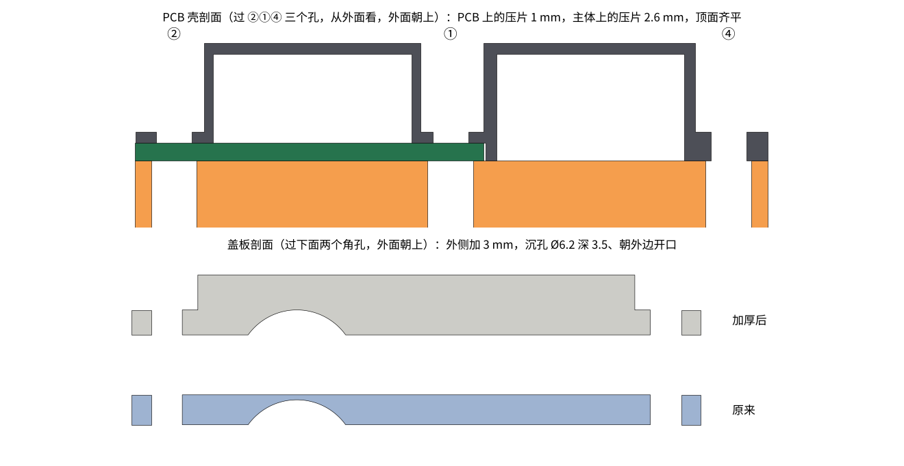
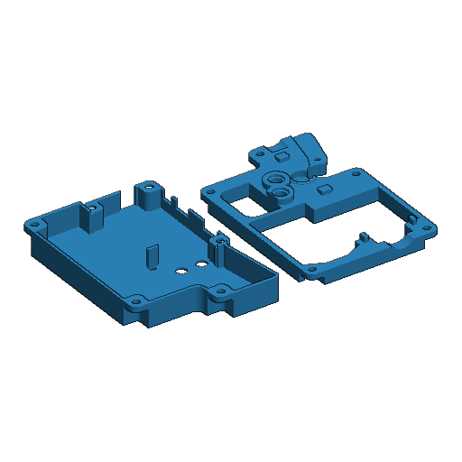

# SEMI-AMS 外壳改版：整面 PCB 保护壳 + 加厚盖板

原厂的 PCB 保护壳只罩住 PCB，旁边的电机和走线露在外面。另一面的盖板只有 3 mm 厚，缓冲器会冒出来一点。这两件都改了：

- **PCB 保护壳（整面版）** `semi-ams-pcb-shell_full.stl`：外轮廓和主体装 PCB 的那一面一样大，把整面罩住。
- **盖板（加厚版）** `semi-ams-cover_thick.stl`：往外侧加厚 3 mm（3 mm → 6 mm），螺丝孔做成沉孔，沉孔朝外边开口。
- **Bambu Studio 工程** `semi-ams-enclosure.3mf`：两件排在一块板上，带打印参数，打开就能切片（见"打印"）。

两件都是在原厂 STL 的基础上改的，原来的结构尽量不动。



## PCB 保护壳（整面版）



- 原壳整块保留，在它外面往外扩。顶板、刻字、两个按钮孔、两个 LED 小窗，以及贴着主体边缘那两面墙上的开口都原样保留。开口包括电源线（P）出口、烧录口，以及给电感、电容让位的口。
- 原壳靠电机一侧和靠下一侧的两面墙去掉了，PCB、电机和走线现在在同一个腔里。
- 外表面高度不变，还是 PCB 上方 9 mm。新扩出来的部分，口沿直接压在主体表面上，比压 PCB 的口沿低 1.6 mm（板厚）。
- 一共六颗 M3 螺丝，做法都和原壳一样：边上开缺口，缺口底下是压片。

  | 孔（主体坐标） | 压在哪 | 压片厚 |
  |---|---|---|
  | ① (28.5, 79)、② (53.36, 79)、③ (53.36, 34.26)：原 PCB 的三个孔 | PCB 上 | 1 mm（原壳的） |
  | ④ (3.5, 79)、⑤ (3.5, 14.84)、⑥ (32.68, 3.5)：主体上另外三个 Ø4.1 孔，装 M3 热熔螺母 | 主体表面 | 2.6 mm |

  六个压片的顶面一样高，螺丝夹住的厚度都是 2.6 mm（PCB 上是压片 1 + 板 1.6），所以六颗用同一种长度。按热熔螺母的长度选 M3×6 或 M3×8。
- ① 原来在壳的左上角，左边现在是新壳，补了一道墙封住。③ 的下边也一样补了墙。缺口只朝主体外边开。
- 原壳上的 "M"（电机线出口）现在在壳里面了，刻字已填平。六个螺丝孔都是 Ø3.2（原壳是 3.0）。
- 电机比主体表面凸出约 3.5 mm，壳内高 9.6 mm，还剩约 6 mm。

## 盖板（加厚版）



- 只往外面加：朝内那一面的孔、凸台、导管槽和斜面一点没动，装回主体的位置不变。窗口照样贯通，只是深了 3 mm，缓冲器不会再冒出外表面。
- 5 个螺丝孔做成 Ø6.2、深 3.5 的沉孔，外表面是平的，沉孔朝最近的外边开口。这几个孔离外边都只有 3.5 mm（盖板的圆角就是以孔心为圆心画的），做成封闭沉孔外侧只剩 0.4 mm。字正着看时左上角那个孔离大窗口只有 0.07 mm，沉孔就直接和窗口连通了。
- 内六角圆柱头（头 Ø5.5，高 3）和圆头、盘头螺丝都能沉到表面以下。头下面还剩 2.5 mm 料（原来是 3 mm），原来的螺丝可以继续用。
- 外表面的 SEMI-AMS 刻字（深 1 mm）挪到了新的外表面上，原来的刻字槽填平了。

## 剖面



## 打印

直接打开 `semi-ams-enclosure.3mf`：一块板，两件都是外表面朝下，和原厂件一样不用支撑。打开就是 P2S + PETG HF + 下面这套设置，不会提示"不是来自 Bambu Lab"。STL 也是同样的打印姿态。



**工程预设**（和卡座支架共用 `../bracket/bambu_project_settings.json`，都是 Bambu Studio 自带的系统预设）：

| 项目 | 预设 |
|---|---|
| 打印机 | Bambu Lab P2S 0.4 nozzle |
| 耗材 | Bambu PETG HF @BBL P2S 0.4 nozzle。想用 PLA 就把耗材 1 换成对应预设，零件上的设置不受影响 |
| 工艺 | 0.20mm Standard @BBL P2S。压片顶面 8、压 PCB 的口沿 9、压主体的口沿 10.6 都是 0.2 的整数倍 |
| 热床 | 纹理 PEI 板。两件的外表面都是贴床那面，会带纹理；想要光面就换光面板，PETG 要先涂胶水 |

**零件上的单独设置**（在对象列表里零件下面能看到，换工艺预设也不会丢；两件一样）：

| 设置 | 值 | 为什么 |
|---|---|---|
| 墙生成器 | Arachne | PCB 壳的墙只有 0.8~1.2 mm，用变线宽两圈填满不留缝；经典模式在 1 mm 的墙里会留一条缝 |
| 墙层数 | 3 | 盖板的框和六个压片三圈基本就实心了；PCB 壳的薄墙实际只放得下两圈 |
| 底层 | 5 层（1 mm） | PCB 壳的顶板正好 1 mm，整块实心，刻字、按钮孔、LED 窗都在这 5 层里；盖板最外 1 mm 也是实心 |
| 顶层 | 5 层 | 压片顶面（螺丝头压的面）和口沿都是实心 |
| 稀疏填充 | 25% 螺旋体 | 只有盖板的框和压片厚到会用上填充，螺丝拧紧不会塌 |
| 接缝 | 后方 | 两件都是外表面朝下，接缝只在侧面，统一放到后面 |
| 裙边 | 关 | 外表面就是贴床那一面，边缘要干净。整面贴床，PETG 不会翘 |
| 支撑 | 关 | 朝下的面只有 PCB 壳缺口里压片的底面、盖板沉孔的顶面，都是 6 mm 左右的短桥接，两三面有墙托着 |

3MF 由 `enclosure.py` 生成，重新生成会覆盖。在 Bambu Studio 里改的设置要同步改到 `enclosure.py` 的 `PRINT_SETTINGS`，不然下次生成就没了。

## 重新生成

```
python3 enclosure.py        # 读原厂 STL，输出两个新 STL 和 3MF 工程
python3 check.py            # 装到主体上检查干涉、对位，以及盖板朝内一面有没有变
python3 render_images.py    # 重新出 images/ 里的图（用 ../bracket/render.py）
```

- 原厂文件默认从 `~/SynologyDrive/3D打印/20260819_semi-ams/` 读，用到 `SEMI-AMS-main-body.stl`、`SEMI-AMS-PCB保护壳.stl` 和 `SEMI-AMS-cover.stl`。别的目录可以作为第一个参数传进去。
- 依赖：`pip3 install trimesh manifold3d shapely numpy matplotlib pillow`。写 3MF 用的是 `../bracket/` 里的 `bambu3mf.py`、`render.py` 和 `bambu_project_settings.json`。
- PCB 壳是按高度分层在 2D 里合成、再逐层拉伸叠起来的（原壳本身就是纯分层的结构），所以导出的网格是干净的封闭实体，切片软件不会报"已修复错误"。
- 参数都在 `enclosure.py` 开头的 `P` 里：PCB 板厚（默认 1.6，实测不同就改）、新侧壁厚、缺口大小、盖板加厚量、沉孔直径和深度。

`check.py` 的结果：

| 项目 | 结果 |
|---|---|
| PCB 壳和主体、PCB（1.6 板）、电机（Ø24.4 圆柱）的干涉 | 都是 0 |
| 六个压片的位置 | ①②③ 压片 z 8~9（贴 PCB），④⑤⑥ 压片 z 8~10.6（贴主体） |
| 盖板从原外表面往里 1.5 mm 以后的截面，和原件比 | 完全一样 |
| 盖板装到主体上的干涉 | 和原件一样（0） |
| 两个 STL 的网格（按位置合并顶点后） | 封闭、没有非流形边、各是一个实体 |

## 坐标

都沿用原厂 STL 的坐标：

- **主体**：装 PCB 的那一面是 z=0，往外是 −z；盖板那一面是 z=22.5。
- **原 PCB 壳**：外表面 z=0，压 PCB 的口沿 z=9；XY 平移 (25.55, 30.75) 就和主体坐标重合（三个孔正好对上主体的孔）。
- **新 PCB 壳**：外表面 z=0，压 PCB 的口沿 z=9，压主体的口沿 z=10.6。装上去就是整体平移 z −10.6。
- **盖板**：外表面 z=0（加厚前），朝内的面 z=3。装到主体上是 y→82.5−y、z→25.5−z。加厚版的外表面在 z=0，原来的部分整体往上移了 3 mm。
