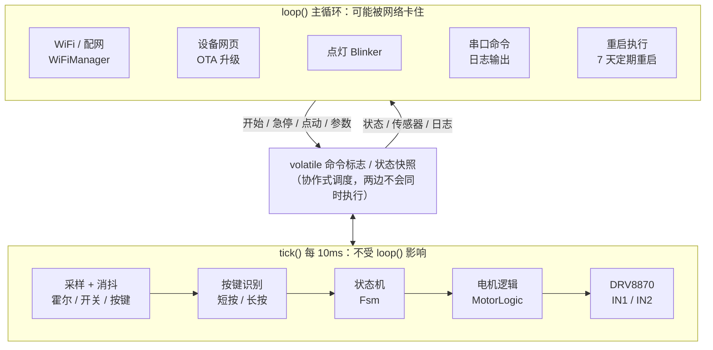
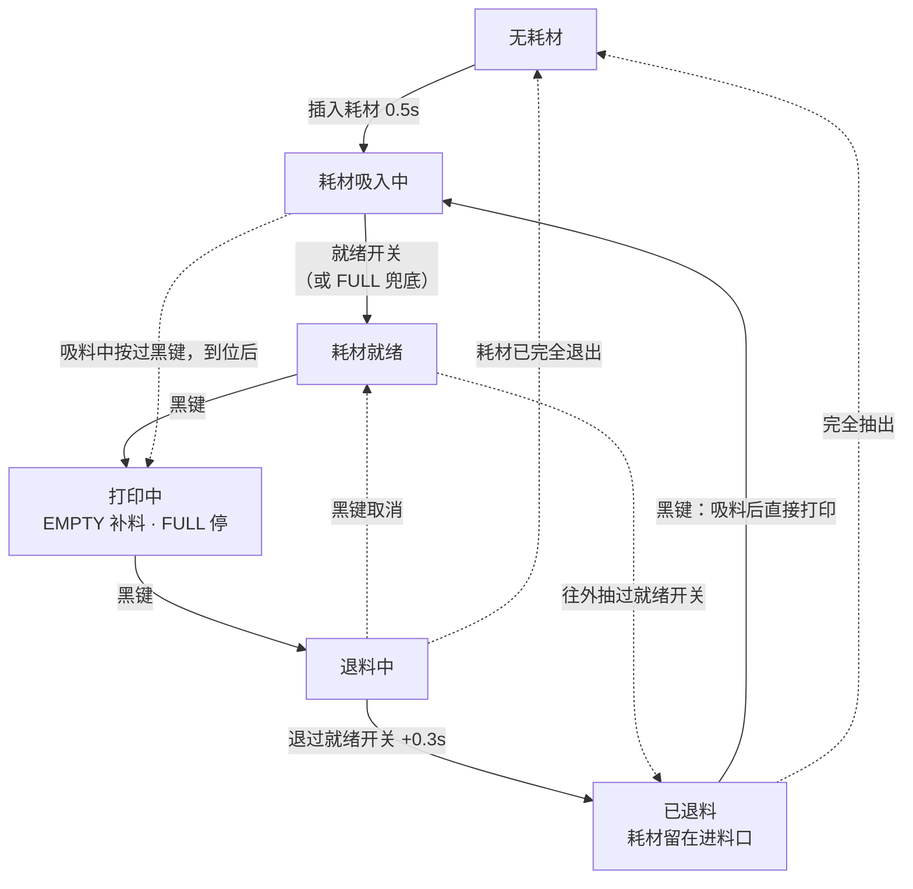
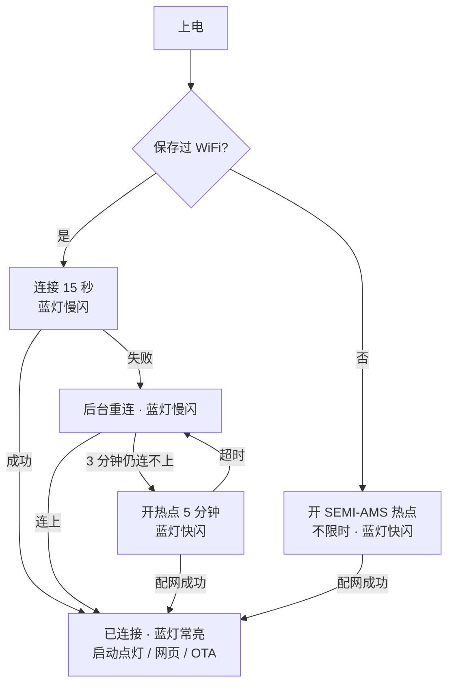
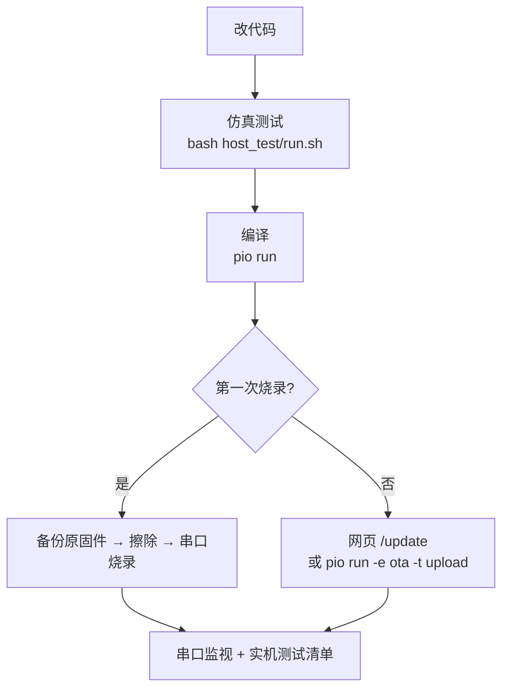

# SEMI-AMS 复刻固件技术文档

| 项目 | 内容 |
|---|---|
| 固件版本 | v1.0.0 |
| 文档日期 | 2026-11-01 |
| 主控 | ESP-12S（ESP8266EX，4MB Flash） |
| 工程位置 | `~/Workspace/pzgz/semi-ams-firmware` |
| 原厂资料 | `~/SynologyDrive/3D打印/20260819_semi-ams/` |
| 开发框架 | PlatformIO + Arduino（ESP8266 core 3.1.2） |
| 当前状态 | 代码完成，仿真测试通过；**尚未在真实工具链上编译，也未上板实测** |

---

## 1. 背景

### 1.1 设备是什么

SEMI-AMS 是给拓竹打印机外置料盘用的半自动供料器，同时带缓冲器。它由以下几部分组成：

- 一个直流减速电机，由 DRV8870 驱动。
- 两个微动开关：进料口开关和就绪开关。
- 一个带磁铁的缓冲滑块，用两颗霍尔传感器（EMPTY / FULL）检测它的位置。
- 两个按键：黑色 Start/Stop，红色 Emergency。
- ESP-12S 主控，可以通过点灯 Blinker App 远程控制。

原厂只提供编译好的 `.bin` 固件，没有源码。

### 1.2 为什么要重写固件

使用中发现一个故障：**磁铁到了霍尔旁边却偶尔检测不到，必须把磁铁拿开一段距离再靠近才能恢复。** 排查过程和结论如下：

| 排查项 | 结论 |
|---|---|
| 霍尔旁的 100nF 去耦电容（C8/C9） | 由 Gerber 确认，电容和 VCC 引脚同在一层直连，焊盘间距约 0.6mm，布局没问题。电源噪声最多影响一次 50ms 的采样，下一次就会自己纠正，无法解释"一直卡住"。**不是原因。** |
| 霍尔芯片 DRV5032FA | 推挽输出，3.3V 供电在规格内，全极型（N/S 都能触发）。芯片本身不需要"先释放再触发"。 |
| 换大磁铁 | 问题基本消失，说明和磁场变化的方式有关。 |
| 在旁边晃动磁铁 | 不能恢复，只有拿开再靠近才行，说明有某个状态"记住了"错误结果。 |
| 在两颗霍尔之间直接移动 | 容易漏检；先特意拿开一段时间再靠近则不漏。说明问题取决于两次事件之间的间隔。 |
| 原厂固件字符串 | 出现 `Configuring pins and interrupts...`，说明原固件用中断按边沿处理传感器事件。 |

**结论：** 最可能的原因是原固件按边沿处理事件，两次事件间隔太短时丢掉了一个边沿，导致内部状态和实际电平不一致，一直要等到下一对边沿出现才恢复。这个判断还没有用万用表测 OUT 脚电压最终证实，但新固件的设计让这类问题不可能再发生，详见 4.4 节。

### 1.3 原厂资料（`~/SynologyDrive/3D打印/20260819_semi-ams/`）

| 文件 | 说明 |
|---|---|
| `离线单机版.bin` | 无联网版本 |
| `远程控制版本（无MQTT).bin` | 本固件的复刻对象，原版号 V2.5.4 |
| `远程控制版本（支持MQTT).bin`、`…MQTT&兼容tpu).bin` | 带拓竹 MQTT 和 TPU 助力的版本，本期不做 |
| `app控制界面配置.txt` | 点灯 App 界面配置，本固件直接沿用 |
| `烧录教程.pdf` | 原厂烧录与配网教程 |
| `Gerber_PCB2_*.zip`、`Netlist_*.net`、`semi-ams_bom.xlsx` | PCB、网表、BOM |

从原固件中提取到的关键信息：

- **状态机**：状态有 `NO_MATERIAL`、`MATERIAL_LOADING`、`MATERIAL_READY`、`PRINTING`、`EMERGENCY_STOPPED`。事件有 `MATERIAL_IN/OUT/READY/UNREADY/FULL/LACK`、`PRINTER_START/STOP`、`EMERGENCY_STOP/RESUME`。
- **中文显示名**：无耗材、耗材吸入中、耗材就绪、打印中、紧急停止。
- **就绪开关兜底**：日志里有 `Ready Check Failed! Use Full Check instead.`，即就绪开关没触发时用 FULL 霍尔判断就绪。
- **配网**：使用 AsyncWiFiManager，热点名 `SEMI-AMS`，自定义字段 `Blinker Secret`。
- **点灯控件 key**：`btn-start-stop`、`btn-emergency`、`btn-restart`、`btn-mqtt`、`tex-state`、`tex-motor`、`tex-runtime`、`tex-ip`、`num-rssi`，运行时长格式为 `x天x时x分`。

---

## 2. 需求

### 2.1 功能需求

| 编号 | 需求 | 实现 |
|---|---|---|
| F1 | 进料口插入耗材后自动吸入，到就绪位置停止 | 插入并保持 0.5 秒后正转吸入，就绪开关触发即停。就绪开关失效时，用 FULL 霍尔兜底 |
| F2 | 黑色按钮开始打印 | 就绪时按下进入打印状态，先送料到缓冲器满 |
| F3 | 打印中自动补料 | EMPTY 触发开始补料，FULL 触发停止 |
| F4 | 打印结束自动退料 | 打印中按黑色按钮开始反转。**退过就绪开关后再多退 0.3 秒停止，耗材留在进料口**（状态"已退料"） |
| F5 | 退料后还能重新进料 | "已退料"时按黑色按钮，先把耗材吸回就绪位置，再直接进入打印送料 |
| F6 | 红色按钮紧急停止 | 任何状态下按下立即停机，再按一次恢复到原来的状态 |
| F7 | 长按任意键重启 | 按住 3 秒，蓝灯急闪后松开即重启 |
| F8 | 每 7 天自动重启 | 运行满 7 天且处于空闲状态时执行 |
| F9 | 联网远程控制 | 点灯 Blinker，沿用原厂 App 界面配置 |
| F10 | 配网 | `SEMI-AMS` 热点，填写 WiFi 和 Blinker 密钥。蓝灯慢闪 = 连接中，快闪 = 配网中，常亮 = 已连接 |
| — | TPU 助力、拓竹 MQTT 自动进退料 | **本期不做**。App 里的 MQTT 按钮显示为灰色"MQTT未启用" |

### 2.2 非功能需求

| 编号 | 需求 | 实现 |
|---|---|---|
| N1 | 不再漏检 | 所有传感器每 10ms 按电平判断，不依赖边沿 |
| N2 | 网络卡顿不影响电机 | 采样、状态机和电机控制运行在独立的 10ms 系统定时器里 |
| N3 | 异常可以自我保护 | 吸入、补料、退料都有超时，超时后进入紧急停止；固件升级时自动停电机 |
| N4 | 现场可调参 | 速度、方向、超时等参数可以在网页或串口修改，保存在 Flash |
| N5 | 逻辑可离线验证 | 状态机、电机和按键逻辑是纯 C++，可以在 Mac 上跑仿真测试 |
| N6 | 上电安全 | 上电或重启后不会自动转电机，只有"插入耗材"这个动作会触发吸入 |

---

## 3. 硬件

### 3.1 主要器件

| 位号 | 器件 | 说明 |
|---|---|---|
| U1 | ESP-12S | ESP8266EX + 4MB Flash，板载蓝灯接 GPIO2 |
| U10 | DRV8870 | H 桥电机驱动。VREF 接 3V3、采样电阻 R8 = 0.2Ω，所以限流约 3.3 / (10 × 0.2) ≈ **1.65A** |
| U17 | CN3903 | 24V 降压到 3.3V |
| U11 / U12 | DRV5032FA | 霍尔开关：推挽输出、全极型、20Hz 采样。动作点最大 4.8mT，释放点最小 0.5mT |
| U13 / U14 | 微动开关 | 进料口开关 IN_CHECK、就绪开关 READY_CHECK，都接到 GND |
| U18 / U19 | 轻触按键 | 黑色 START-STOP、红色 EMERGENCY |

### 3.2 引脚分配

| GPIO | 连接 | 有效电平 | 固件设置 |
|---|---|---|---|
| 12 | U11 EMPTY 霍尔 | 低 = 缓冲器空 | `INPUT` |
| 13 | U12 FULL 霍尔 | 低 = 缓冲器满 | `INPUT` |
| 4 | U13 进料口开关 | 低 = 有耗材 | `INPUT_PULLUP` |
| 5 | U14 就绪开关 | 低 = 就绪 | `INPUT_PULLUP`。**这个脚同时驱动缺料红灯的 MOS 管，严禁设为输出** |
| 0 | 黑色按钮（R3 10k 上拉） | 按下为低 | `INPUT_PULLUP` |
| 15 | 红色按钮（R14 4.7k 接 3V3） | 按下为高 | `INPUT`（模组内部下拉） |
| 14 | DRV8870 IN1 | — | `OUTPUT` / PWM |
| 16 | DRV8870 IN2 | — | `OUTPUT` / PWM |
| 2 | 板载蓝灯 | 低电平亮 | `OUTPUT` |

### 3.3 硬件注意事项

以下来自网表和 Gerber 分析，供以后改板参考。

1. **连接器额定电流偏低**：CN1（24V 输入）和 CN3（电机）都是 1.25mm 间距、额定 1A 的连接器，而电机堵转时限流约 1.65A。R8 在 1.65A 时功耗约 0.54W，超过它 0.5W 的额定值。建议按电机实际电流把 R8 改成 0.33Ω（约 1A）。
2. **红色按钮的接法余量不足**：按下时 GPIO15 的电压由 R14 和模组内部下拉分压决定，余量不大。C24 跨接在按键两端，起不到对地消抖的作用。实测时要确认红色按钮每次都能识别；网页日志里会显示"红色按钮"。
3. **上电时不要按着按钮**：上电时按住黑色按钮会进入下载模式，按住红色按钮会导致启动失败。
4. **霍尔的位置**：两颗霍尔相距约 18.9mm。U11 的背面是 ESP-12S 的屏蔽罩，U12 的背面是 CN3903，两边磁场环境不完全相同。
5. **磁铁选型**（N35，磁极面正对芯片，间距 4mm 时的理论值）：

| 磁铁 直径×厚 | 正下方场强 | 另一颗霍尔处 | 触发区宽度 |
|---|---|---|---|
| 3×2mm | 20 mT | 0.15 mT | 7.6 mm |
| 4×2mm | 33 mT | 0.26 mT | 9.4 mm |
| 5×2mm | 45 mT | 0.41 mT | 10.6 mm |
| 6×3mm | 72 mT | 0.82 mT | 12.8 mm |
| 8×3mm | 97 mT | 1.5 mT | 14.8 mm |
| 10×3mm | 113 mT | 2.3 mT | 16.4 mm |

3×2 到 5×2mm 最合适。磁铁太大时，可能让另一颗霍尔无法释放，或者让两个触发区连在一起。

---

## 4. 软件设计

### 4.1 架构



**为什么分成两个执行上下文：** ESP8266 是协作式调度。点灯库连接服务器、配网页面处理请求时，`loop()` 可能被卡住好几秒。传感器、状态机和电机放在 `Ticker` 的 10ms 回调里，只要网络代码在等待时让出 CPU，它就照常运行，缓冲器满了能及时停电机。两边通过几个 `volatile` 标志交换命令；因为是协作式调度，两边不会同时执行，所以不存在竞争。

### 4.2 文件结构

| 文件 | 作用 | 是否依赖硬件 |
|---|---|---|
| `src/fsm.h/.cpp` | 状态机：全部业务逻辑 | 否，可以仿真测试 |
| `src/motor_logic.h` | 电机控制：起步、加速、刹车、换向、PWM 计算 | 否，可以仿真测试 |
| `src/input.h` | 消抖、按键短按/长按识别 | 否，可以仿真测试 |
| `src/main.cpp` | 引脚初始化、10ms tick、日志、串口命令、重启 | 是 |
| `src/net.h/.cpp` | WiFi 配网、设备网页、OTA、mDNS | 是 |
| `src/cloud.h/.cpp` | 点灯 Blinker 控件 | 是 |
| `src/settings.h/.cpp` | 参数读写（LittleFS） | 是 |
| `src/app.h` | 各模块共用的接口 | — |
| `include/config.h` | 引脚、网络、时间、电机等常量 | — |
| `host_test/` | 电脑上运行的仿真测试 | — |
| `platformio.ini` | 编译、烧录、OTA 配置 | — |

### 4.3 状态机



实线是正常使用流程，虚线是特殊情况。图里没有画出以下几种转换，见下表：

- **紧急停止**：任何状态下按红色按钮，或者任一阶段超时，都会进入紧急停止；再按一次红色按钮回到进入前的状态。
- **上电初始状态**：就绪开关有耗材进入"耗材就绪"，只有进料口有耗材进入"已退料"，都没有进入"无耗材"。
- 其它少见的转换：吸入中耗材被抽出回到无耗材；就绪时耗材被完全抽出回到无耗材；已退料时手动把耗材推到就绪开关进入就绪。

| 状态 | 电机 | 说明 |
|---|---|---|
| 无耗材 | 停 | 要先看到进料口为空，下一次插入才会触发自动吸入，防止用户往外抽料时被电机吸回去 |
| 耗材吸入中 | 正转，吸入速度 | 就绪开关触发即停。FULL 霍尔只有在吸入过程中**新触发**才算就绪，防止滑块本来就停在 FULL 造成误判。超时 30 秒 |
| 耗材就绪 | 停 | 等待黑色按钮 |
| 打印中 | 补料时正转，补料速度 | 进入后先送到 FULL，首次超时 120 秒。之后 EMPTY 触发开始补料、FULL 触发停止，每次超时 30 秒。两颗霍尔同时有效时以 FULL 为准。两个开关都没耗材时停止补料，备注"耗材已用尽"；换上新耗材后延时 0.5 秒，按首次送料超时重新送到满 |
| 退料中 | 反转，退料速度 | 就绪开关松开后再退 `unload_extra_ms` 就停，进入"已退料"。如果退料全程就绪开关都没触发过（开关失效），就一直退到进料口也为空。超时 90 秒。退料中按黑键可以取消 |
| 已退料 | 停 | 耗材停在进料口里，按黑键会重新吸料并开始打印 |
| 紧急停止 | 停 | 只响应红键（恢复）和长按重启，备注里显示原因，例如"送料超时" |

### 4.4 传感器与按键

| 输入 | 消抖 | 判断方式 |
|---|---|---|
| 霍尔 EMPTY / FULL | 连续 2 次一致（20ms） | 电平 |
| 微动开关 IN / READY | 连续 5 次一致（50ms） | 电平 |
| 黑色按钮 | 40ms | **松开时**触发短按。按住超过 3 秒后松开 = 重启 |
| 红色按钮 | 40ms | **按下瞬间**触发，急停要越快越好。按住超过 3 秒后松开 = 重启 |

**为什么不会再漏检：** 状态机每 10ms 读取一次各传感器的稳定电平，并据此做决定，例如"打印中且 FULL 有效就停止补料"。它不记录"发生过什么边沿"，所以不存在丢边沿的问题。即使某次变化没赶上，下一个 10ms 也会按实际电平纠正。

DRV5032 自身每 50ms 采样一次，最多带来 50ms 的延迟，对缓冲器来说没有影响。

上电时已经按着的按键会被忽略，要等松开后才开始识别。

### 4.5 电机控制

DRV8870 真值表：

| IN1 | IN2 | 动作 |
|---|---|---|
| 0 | 0 | 滑行（同时进入低功耗） |
| 1 | 0 | 物理正向 |
| 0 | 1 | 物理反向 |
| 1 | 1 | 刹车 |

- **调速方式：慢衰减 PWM。** 一路保持高电平，另一路输出反相 PWM，电机在"驱动"和"刹车"之间切换。低速时的力矩和线性比滑行方式好。PWM 频率 5kHz，占空比分辨率 1%。
- **起步**：从 25% 占空比开始，每 10ms 增加 3%，直到目标速度。
- **停止**：先刹车 150ms 再滑行，送料停得干脆。
- **换向**：必须先经过刹车，不会直接反转。
- **方向反转设置**（`motor_invert`）：只在电机完全停下后才生效。
- **引脚写入顺序**：先写固定电平的脚，再写 PWM 脚，避免切换瞬间出现反向脉冲。

### 4.6 网络



- **配网**：WiFiManager 2.0.17，以非阻塞模式运行，配网期间按键和送料照常工作。如果之前配过网（例如停电后路由器启动慢），先在后台重连 3 分钟，不急着开热点。
- **点灯 Blinker**：
  - 控件 key 和原厂一致，见 8.3 节。
  - App 打开或发送心跳时，刷新全部控件。
  - 状态变化时主动推送，最小间隔 1.5 秒，多次变化合并成一条，以满足点灯"设备每秒最多 1 条"的限制。
  - 点灯库在 ESP8266 上默认不使用 SSL（`BLINKER_WITHOUT_SSL`），这样内存占用小、阻塞时间短。
  - 点灯库的 `begin()` 会重新连接一次 WiFi，并把 DHCP 主机名改掉，固件随后会把主机名改回 `semi-ams`。
- **mDNS**：点灯库会用它自己的设备名注册 mDNS。所以设置了点灯密钥后，网页和 OTA 请用 IP 访问；没设置时可以用 `semi-ams.local`。
- **设备网页**：`http://设备IP/`。可以查看状态、传感器和日志，执行开始/急停/点动/重启，修改参数，重置配网，以及打开升级入口。接口见 8.2 节。
- **固件升级**：
  - 网页升级：`/update`，用户名 `admin`，密码 `semi-ams`。
  - PlatformIO 无线升级：`pio run -e ota -t upload`。
  - 升级开始时状态机强制进入紧急停止。

### 4.7 参数与存储

参数保存在 LittleFS 的 `/settings.txt` 中，格式为每行一个 `key=value`。点灯密钥也存在这个文件里，WiFi 账号密码由 ESP8266 SDK 自己保存。

| 参数 | 默认 | 范围 | 说明 |
|---|---|---|---|
| `load_speed` | 50 | 10–100 % | 吸入速度 |
| `feed_speed` | 60 | 10–100 % | 打印补料速度，网页点动也用这个速度 |
| `unload_speed` | 60 | 10–100 % | 退料速度 |
| `motor_invert` | 0 | 0/1 | 电机方向反转 |
| `insert_delay_ms` | 500 | 0–5000 | 插入耗材后多久开始吸入 |
| `load_timeout_s` | 30 | 3–600 | 吸入超时 |
| `first_feed_timeout_s` | 120 | 5–900 | 开始打印或换料后，首次送到满的超时 |
| `feed_timeout_s` | 30 | 3–600 | 打印中每次补料的超时 |
| `unload_timeout_s` | 90 | 5–900 | 退料超时 |
| `unload_extra_ms` | 300 | 0–10000 | 退料时离开就绪开关后再多退的时间 |

不常改的常量在 `include/config.h` 中，包括：PWM 频率、起步占空比、刹车时间、长按时间、消抖次数、热点名称和密码、OTA 密码、重连和热点时长。

### 4.8 安全机制

- **超时保护**：吸入、首次送料、补料、退料都有超时，超时后进入紧急停止，并在备注里显示原因。
- **升级保护**：通过网页或 OTA 升级时，强制紧急停止。
- **重启保护**：所有重启都先停电机。如果 `loop()` 被网络卡住超过 5 秒，tick 会直接执行重启。
- **上电保护**：上电或重启后不转电机。
- **方向保护**：电机运行中修改方向设置不会立即生效，换向一定先经过刹车。

### 4.9 与原固件的差异

| 方面 | 原固件 | 本固件 |
|---|---|---|
| 传感器 | 中断 + 边沿 | 10ms 电平轮询 |
| 电机控制所在 | 主循环 | 独立的 10ms 定时器 |
| 退料 | 退完（推测为退出进料口） | 退到就绪开关后停，耗材留在进料口；按黑键重新吸料并开始打印 |
| 超时保护 | 不明 | 各阶段都有 |
| 配网 | AsyncWiFiManager，连不上就重启 | WiFiManager 非阻塞，配网时设备照常工作 |
| 调参与调试 | 无 | 网页、串口、点动、日志 |
| 状态 | 5 个 | 7 个（新增退料中、已退料） |
| MQTT / TPU | 有对应版本 | 不支持 |

---

## 5. 在 Mac 上开发、编译、烧录、测试



### 5.1 准备环境（只需一次）

```bash
# 1. 命令行编译工具（仿真测试要用 c++）
xcode-select --install

# 2. PlatformIO（二选一）
brew install platformio              # 命令行版
# 或：安装 VS Code，在扩展里搜索安装 "PlatformIO IDE"

# 3. esptool（用来备份和恢复原厂固件）
brew install esptool
```

**Apple 芯片不需要 Rosetta：** PlatformIO 仓库里的 ESP8266 编译器 `toolchain-xtensa`（GCC 10.3）只有 Intel 版。在 Apple 芯片的 Mac 上不装 Rosetta 2 直接用，会报 `xtensa-lx106-elf-g++: Bad CPU type in executable`。苹果已经宣布 Rosetta 2 会逐步停用，所以本工程在 `platformio.ini` 的 `platform_packages` 里，把编译器换成了 ESPHome 维护的原生 arm64 版：

- 仓库：`esphome-libs/xtensa-lx106-elf-toolchain`，版本 `10.3.0-esphome.3`。
- 同为 GCC 10.3，作者逐一验证过，生成的代码与 PlatformIO 官方包 `2.100300.220621` 一致；唯一的差别是两处 newlib 改动，可以省下约 400 字节 RAM。
- ESPHome 从 2026.10 版起，ESP8266 默认就用这个编译器。
- 第一次编译时 PlatformIO 会自动下载约 58MB。如果要在 Intel Mac、Linux 或 Windows 上编译，删掉 `platformio.ini` 里的那两行 `platform_packages` 即可。
- 只有编译器需要替换。生成固件和烧录用的都是 Python 写的 esptool，在 Apple 芯片上原生运行。

**只装了 PlatformIO 插件时，终端里没有 `pio` 命令：** 插件把 PlatformIO Core 装在 `~/.platformio/penv/` 下，但不会加到 PATH。可以临时用 `~/.platformio/penv/bin/pio run`；也可以一次性加进 PATH：

```bash
mkdir -p ~/.local/bin
ln -sf ~/.platformio/penv/bin/pio ~/.local/bin/pio
ln -sf ~/.platformio/penv/bin/platformio ~/.local/bin/platformio
echo 'export PATH="$PATH:$HOME/.local/bin"' >> ~/.zprofile    # 然后重新打开终端
```

**串口驱动：** 先执行一次 `ls /dev/cu.*`，插上 CH343P 串口工具后再执行一次，多出来的那一项就是串口。名字可能是 `cu.wchusbserial…`、`cu.usbserial…` 或 `cu.usbmodem…`。如果什么都没多出来，到沁恒（WCH）官网下载 CH34X/CH343 的 macOS 驱动。原厂教程截图里用的是 `/dev/cu.wchusbserial…`。

**工程位置与版本管理：** 工程放在 `~/Workspace/pzgz/semi-ams-firmware`，不在 Synology Drive 的同步目录里，所以编译生成的 `.pio/`（几百 MB）不会被同步。建议在工程目录里执行一次 `git init` 做版本管理，`.gitignore` 已经排除了 `.pio/`、`.vscode/` 和 `.DS_Store`。原厂资料和固件备份仍然放在 `~/SynologyDrive/3D打印/20260819_semi-ams/`。

### 5.2 先跑仿真测试（不需要开发板）

```bash
cd semi-ams-firmware
bash host_test/run.sh        # 全部通过时显示 "157 passed, 0 failed"
bash host_test/run.sh -v     # 同时打印每一步的状态变化日志
```

修改 `src/fsm.cpp`、`src/motor_logic.h` 或 `src/input.h` 后先跑一遍。新增行为时，在 `host_test/test_main.cpp` 里补一个场景。

### 5.3 编译

```bash
pio run
```

- 第一次编译会自动下载 ESP8266 工具链、Arduino core 3.1.2，以及点灯库（固定在提交 `c73abe1`）和 WiFiManager v2.0.17，需要几分钟。
- 成功后会显示 RAM / Flash 的占用比例，固件文件在 `.pio/build/esp12s/firmware.bin`。
- **这一步还没有在真实工具链上验证过。** 如果报错，把完整输出发回来修改。

在 VS Code 里也可以操作：点左侧 PlatformIO 图标，在 Project Tasks → esp12s 下使用 Build、Upload、Monitor。

### 5.4 接线

和原厂教程一致：

- 串口工具的跳线帽接 **3V3TTL、VIO**。
- 控制板和串口工具的连接：**EN→RTS、TX→RX、RX→TX、GPIO0→DTR、GND→GND**。
- **控制板要接 24V 电源**，CN4 上没有 3V3 供电脚。

### 5.5 备份原厂固件（第一次烧录前必须做）

```bash
esptool.py --port /dev/cu.wchusbserialXXXX --baud 921600 read_flash 0 0x400000 原厂固件备份-4MB.bin
ls -l 原厂固件备份-4MB.bin     # 大小应为 4194304 字节
```

- 4MB 大约需要 1 分钟。
- 把备份文件保存到 `~/SynologyDrive/3D打印/20260819_semi-ams/`，和原厂资料放在一起。
- 新版 esptool 的命令也可以写成 `esptool --port … read-flash 0 0x400000 …`。

### 5.6 第一次烧录

```bash
pio run -t erase                                     # 整片擦除，清掉原固件的 SPIFFS / EEPROM / WiFi 数据
pio run -t upload --upload-port /dev/cu.wchusbserialXXXX
pio device monitor --port /dev/cu.wchusbserialXXXX   # 115200，Ctrl+C 退出
```

- 建议第一次先擦除。原固件把点灯密钥存在 SPIFFS 里，新固件读不了，擦干净以后按正常流程配网最省事。
- 如果上传时报 `Failed to connect`，检查 RTS/DTR 两根线。也可以手动进入下载模式：按住黑色按钮，把 EN 短接一下 GND，然后松开按钮。
- `platformio.ini` 里已经设置了 `monitor_rts = 0`、`monitor_dtr = 0`。打开串口监视器时不会把芯片按在复位状态或下载模式。

启动后串口应该能看到类似下面的输出：

```
[     0] SEMI-AMS 复刻固件 v1.0.0 启动，输入 help 查看串口命令
[     0] 传感器 进料口:0 就绪:0 EMPTY:0 FULL:1
[     0] 状态: 无耗材 -> 无耗材（上电）
[     0] 尚未配网
[     0] 配网模式：手机连接热点 SEMI-AMS ...
```

### 5.7 配网与点灯

1. 手机连接 `SEMI-AMS` 热点，配置页会自动弹出；没弹出就手动打开 192.168.4.1。
2. 选择 WiFi，输入密码，在 Blinker Secret 一栏填点灯密钥，然后点 save。
3. 蓝灯常亮表示已连上。串口里会打印设备 IP。
4. 点灯 App 里的设置和原厂教程一样：添加独立设备，选网络接入，在界面配置里粘贴 `app控制界面配置.txt` 的内容。
5. 浏览器打开 `http://设备IP/`，就是设备网页。

### 5.8 实机测试清单

建议按顺序做，每项都可以在网页的状态栏和日志里确认结果。

| # | 项目 | 操作 | 预期 |
|---|---|---|---|
| 1 | 传感器 | 依次按微动开关，把磁铁移到两颗霍尔上 | 网页对应项变成"有效"，日志出现"传感器 …" |
| 2 | 按键 | 短按黑色和红色按钮 | 日志出现"黑色按钮"/"红色按钮"。**红色按钮要多按几次，确认每次都能识别**（见 3.3 节第 2 条） |
| 3 | 电机方向 | 在空闲状态下点"正转 2 秒" | 耗材往打印机方向走。方向反了就把 `motor_invert` 设为 1 |
| 4 | 自动吸入 | 插入耗材 | 0.5 秒后吸入，就绪开关触发后停止，状态变为"耗材就绪" |
| 5 | 开始打印 | 按黑色按钮 | 送料直到 FULL 后停止 |
| 6 | 补料 | 手动拉动滑块到 EMPTY | 开始补料，到 FULL 停止 |
| 7 | 原故障复现 | 让磁铁在两颗霍尔之间快速来回移动，并在 FULL 旁晃动 | 每次到 FULL 都停止，不需要拿开再靠近 |
| 8 | 退料 | 打印中按黑色按钮 | 反转，就绪开关松开后再退约 0.3 秒停止，状态为"已退料" |
| 9 | 退料停止位置 | 检查耗材尖端的位置 | 尖端仍被齿轮夹住。退过头就把 `unload_extra_ms` 调小 |
| 10 | 重新进料 | "已退料"时按黑色按钮 | 吸回就绪位置后自动进入打印并送料 |
| 11 | 急停 | 在吸入、打印、退料各状态下按红色按钮 | 立即停止；再按一次恢复原状态 |
| 12 | 超时 | 打印中捏住耗材不让走 | `feed_timeout_s` 后进入紧急停止，备注"送料超时" |
| 13 | 长按重启 | 按住任意键 3 秒以上 | 蓝灯急闪，松开后重启，电机不会自己转 |
| 14 | 点灯 | 在 App 上按开始、急停、重启 | 设备响应，状态和电机控件 1–2 秒内刷新 |
| 15 | 断网 | 关掉路由器再打开 | 蓝灯慢闪，路由器恢复后自动连上，期间送料不受影响 |
| 16 | 无线升级 | 用网页 `/update` 上传新的 firmware.bin | 电机自动停止，升级完成后重启 |

### 5.9 调参建议

1. 先用点动确认方向，再分别调吸入、补料、退料三个速度。原则是"不要太快，够打印机用就行"。补料速度要明显大于打印时的耗材消耗速度。
2. 根据 PTFE 管长度和送料速度调整 `first_feed_timeout_s`（首次送到满）和 `unload_timeout_s`。
3. 根据第 9 项测试调整 `unload_extra_ms`，保证退料后齿轮还能夹住耗材。
4. 修改方式：网页参数区改完点保存；或者在串口输入 `set feed_speed 55`。参数立即生效，并保存到 Flash。

### 5.10 日常迭代

```bash
bash host_test/run.sh          # 改了逻辑先跑仿真
pio run                        # 编译
pio run -e ota -t upload       # 无线升级（先在 platformio.ini 的 [env:ota] 填设备 IP）
```

也可以在网页 `/update` 里直接上传 `.pio/build/esp12s/firmware.bin`。

### 5.11 常见问题

| 现象 | 处理 |
|---|---|
| `pio: command not found` | 见 5.1 节：用 `~/.platformio/penv/bin/pio`，或者把它加进 PATH |
| `Bad CPU type in executable` | 用的是 PlatformIO 官方的 Intel 版编译器。确认 `platformio.ini` 里的 `platform_packages` 那两行还在，再重新编译。可以用 `file ~/.platformio/packages/toolchain-xtensa*/bin/xtensa-lx106-elf-g++` 查看，应该显示 `arm64` |
| `pio run` 编译报错 | 把完整输出发回来，按真实工具链的报错修改 |
| 找不到串口 | 用 `ls /dev/cu.*` 对比插拔前后的变化；装 WCH 驱动；换一根数据线 |
| 上传 `Failed to connect` | 检查 RTS/DTR 接线、板子是否接了 24V；或者手动进入下载模式（按住黑键，EN 短接 GND） |
| 串口监视器打开后设备不运行 | 确认 `platformio.ini` 里有 `monitor_rts = 0`、`monitor_dtr = 0` |
| 没有出现配网热点 | 已经配过网时，热点要连不上 3 分钟后才会出现；也可以在串口输入 `wifireset` 清除配置 |
| 点灯显示离线 | 检查密钥；在网页修改密钥后要重启才生效；看串口日志里是否有"点灯 Blinker 已启动" |
| 电机不转 | 用网页点动测试；确认 24V 已接；确认状态不是"紧急停止" |
| 想换回原厂固件 | `esptool.py --port … write_flash 0 原厂固件备份-4MB.bin`，或用 NodeMCU PyFlasher 刷入原来的 `.bin` |

---

## 6. 验证现状

| 验证 | 结果 |
|---|---|
| 仿真测试（`host_test/`） | 22 组场景，157 项检查，全部通过 |
| 语法和类型检查 | 全部源码通过 `g++ -Wall -Wextra` 检查，所用的桩头文件按真实库的函数签名编写 |
| 独立代码审查 | 对照 ESP8266 core 3.1.2、WiFiManager 2.0.17、点灯库源码逐项核对，未发现编译或链接问题。提出的运行时问题已全部修正，包括：点灯启动时会触发 WiFi 重连、改掉主机名；停电后配网热点会占住 5 分钟；换料后误报超时；升级标志没有复位；缺少重启兜底；状态接口造成内存碎片 |
| 真实工具链编译 | **未进行**（开发环境无法访问 PlatformIO 下载源），需要在 Mac 上完成 |
| 上板实测 | **未进行**，按 5.8 节的清单执行 |

仿真测试覆盖的场景：

- 自动吸入；就绪开关失效时用 FULL 兜底；吸入超时及恢复。
- 用户抽出耗材不会被吸回；吸入中被抽出。
- 打印补料；磁铁从 EMPTY 快速移到 FULL；补料超时及恢复。
- 退料到"已退料"；退料取消与超时；就绪开关失效时的退料。
- 打印中耗材用尽，以及之后换料；已退料时按键吸料并开始打印；吸料中按键。
- 满料兜底后的就绪状态保持；任何状态下的急停；上电状态；两颗霍尔同时有效。
- 消抖；按键短按/长按；电机起步、刹车、换向和慢衰减 PWM。

---

## 7. 已知限制与后续工作

- **不支持拓竹 MQTT 自动进退料和 TPU 助力。** 以后要加的话，可以把 MQTT 事件映射成状态机的命令，状态机本身不用改。
- **重启后不会自动恢复到"打印中"。** 打印中途断电后需要再按一次黑色按钮。
- **点灯通信默认不加密**（点灯库在 ESP8266 上的默认设置）。如需加密，可以定义 `BLINKER_WITH_SSL`，代价是占用更多内存、阻塞时间更长。
- **配网热点默认没有密码**，和原厂一致。热点开着时，WiFiManager 自带的升级页面不需要认证。可以在 `config.h` 里设置 `AP_PASSWORD`。
- **硬件改进建议**：见 3.3 节，包括连接器额定电流、R8、红色按钮的接法。
- **原故障的最终确认**：可以在原固件上，在漏检的那一刻测一次霍尔 OUT 脚。如果读到 0V，就证明是原固件丢了边沿。

---

## 8. 附录

### 8.1 串口命令（115200）

| 命令 | 作用 |
|---|---|
| `help` | 显示命令列表 |
| `status` | 显示状态、传感器、网络和全部参数 |
| `start` | 开始/结束，等同黑色按钮 |
| `emg` | 紧急停止/解除，等同红色按钮 |
| `jog f <速度%> <毫秒>`、`jog r …` | 空闲时正转（f）/反转（r）点动电机，例如 `jog f 50 2000` |
| `set <参数> <值>` | 修改参数并保存，例如 `set unload_extra_ms 200` |
| `key <点灯密钥>` | 设置点灯密钥，重启后生效 |
| `restart` | 重启 |
| `wifireset` | 清除 WiFi 和点灯密钥后重启 |

### 8.2 设备网页接口

| 方法 | 路径 | 说明 |
|---|---|---|
| GET | `/` | 设备网页 |
| GET | `/api/status` | 返回 JSON：状态、电机、传感器、运行时长、WiFi、点灯状态、最近 15 条日志 |
| POST | `/api/cmd?c=…` | `c` 取值：`start` 开始/结束、`emg` 急停、`jogf` / `jogr` 正转/反转点动 2 秒、`restart` 重启 |
| POST | `/api/settings` | 表单方式提交参数（留空的项不修改），可以带 `blinker_key` |
| POST | `/api/reset` | 清除 WiFi 和点灯密钥并重启 |
| GET/POST | `/update` | 固件升级（admin / semi-ams） |

### 8.3 点灯控件

| key | 类型 | 内容 |
|---|---|---|
| `btn-start-stop` | 按钮 | 开始/结束 |
| `btn-emergency` | 按钮 | 紧急停止/解除 |
| `btn-restart` | 按钮 | 重启 |
| `btn-mqtt` | 按钮 | 显示为灰色"MQTT未启用"，点击后提示"本固件不支持MQTT" |
| `tex-state` | 文本 | 工作状态，例如"打印中"、"紧急停止（送料超时）" |
| `tex-motor` | 文本 | 正转 / 反转 / 停止 |
| `tex-runtime` | 文本 | 运行时长，格式 `x天x时x分` |
| `tex-ip` | 文本 | 设备 IP |
| `tex-hint` | 文本 | 提示设备网页的地址 |
| `num-rssi` | 数值 | WiFi 信号（dBm） |

### 8.4 蓝灯含义

| 蓝灯 | 含义 |
|---|---|
| 慢闪（1 秒） | 正在连接 WiFi，或在后台重连 |
| 快闪（0.2 秒） | 配网热点 SEMI-AMS 已打开 |
| 常亮 | WiFi 已连接 |
| 急闪 | 长按已满 3 秒，松开即重启 |

### 8.5 依赖版本

| 依赖 | 版本 |
|---|---|
| PlatformIO platform | espressif8266@4.2.1（Arduino core 3.1.2） |
| 点灯 Blinker 库 | blinker-library 0.3.12，提交 `c73abe1`（2025-03-25） |
| WiFiManager | tzapu/WiFiManager v2.0.17 |
| 编译器（Apple 芯片） | esphome-libs/xtensa-lx106-elf-toolchain `10.3.0-esphome.3`（GCC 10.3，darwin_arm64） |
| Flash 布局 | 4MB，其中 1MB 给 LittleFS（`eagle.flash.4m1m.ld`），DOUT 模式 |
