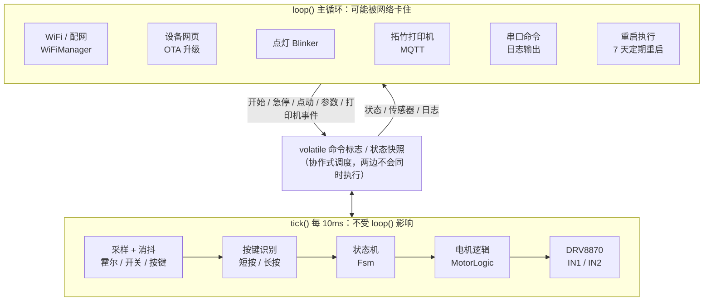
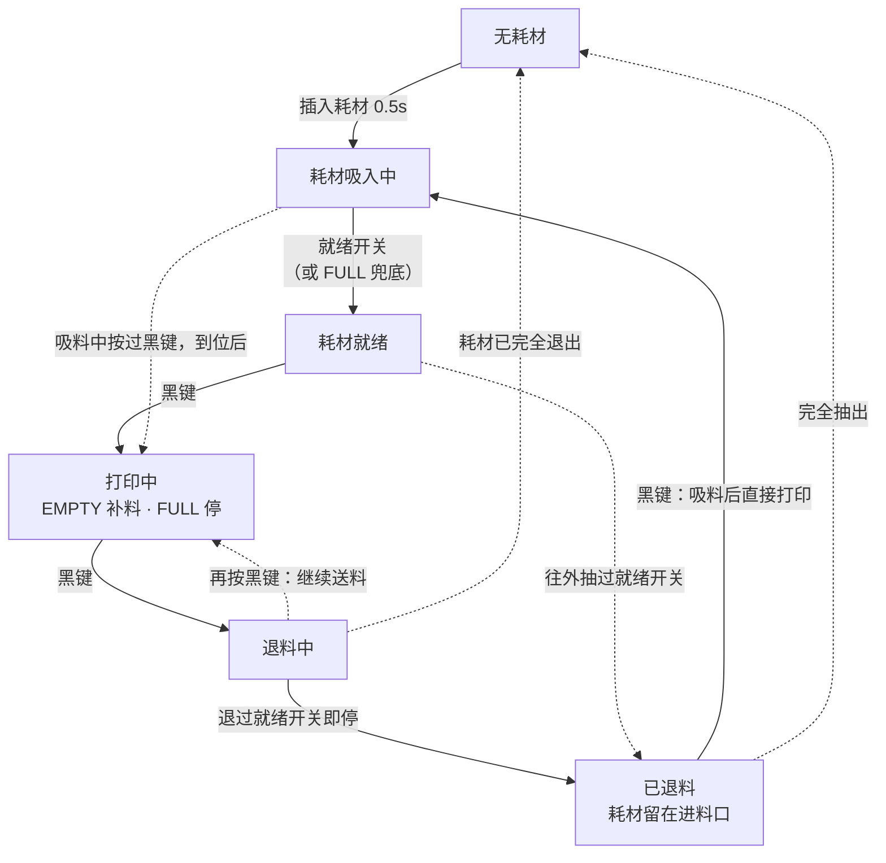
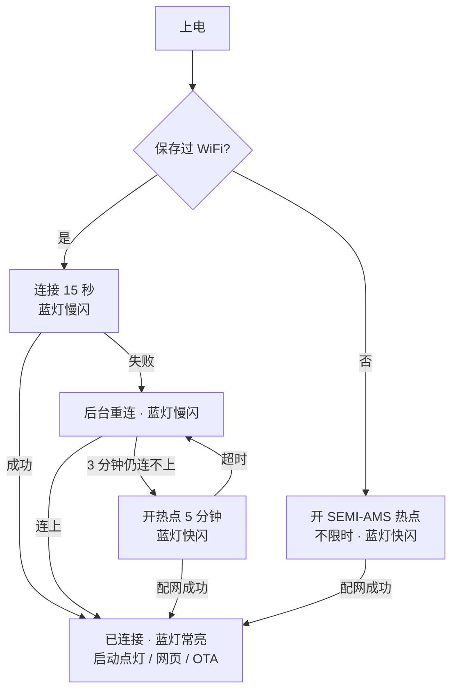
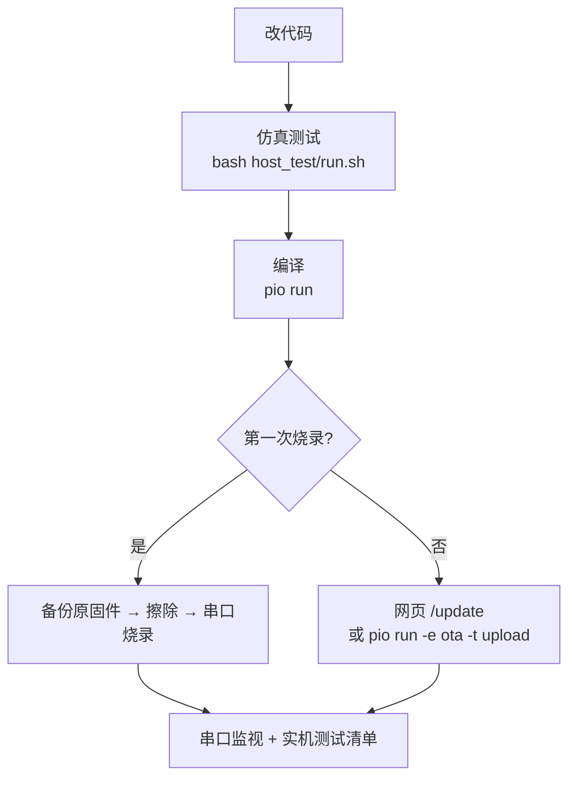

# SEMI-AMS 复刻固件技术文档

| 项目 | 内容 |
|---|---|
| 固件版本 | v1.3.0（新增局域网 MQTT：把状态发布到 Home Assistant、Node-RED 等，可选接受控制命令，见 [局域网MQTT消息参考](局域网MQTT消息参考.md)。v1.2.3：升级、断电、崩溃重启后恢复"打印中"；不在打印中收到打印机退料时写日志；0x07FF8003 也当作拔出提示；进料口开关短暂接通写日志；红色按钮按住 60ms 才算，紧急停止时蓝灯双闪、插入耗材有提示。之前：MQTT 新增"响应进料""响应退料"两个开关；升级等重启前先写完日志；改用 2MB 分区，支持无线升级；打印中的补料改为汇总记录；中文字符串全部移进 Flash；修正内存不足导致的反复重启；崩溃记录） |
| 文档日期 | 2026-11-07 |
| 主控 | ESP-12S（ESP8266EX；这台的模组实测闪存只有 2MB，固件按 2MB 分区，见 3.3 节第 7 条） |
| 工程位置 | `~/Workspace/pzgz/semi-ams/firmware`（GitHub 仓库 `pzgz/semi-ams` 的 `firmware/` 目录） |
| 原厂资料 | `~/SynologyDrive/3D打印/20260819_semi-ams/` |
| 开发框架 | PlatformIO + Arduino（ESP8266 core 3.1.2） |
| 当前状态 | 已在 Mac 上编译并上板运行；送料、退料、按键、料尾已实测；P2S 外置料盘自动送料、退料的完整流程已实测（v1.1.3） |
| 相关文档 | [拓竹MQTT消息参考](拓竹MQTT消息参考.md)（P2S 实测消息整理）；[局域网MQTT消息参考](局域网MQTT消息参考.md)（本机发布的状态和接受的命令）；[多台SEMI-AMS协同方案](多台SEMI-AMS协同方案.md)（待实施） |

---

## 1. 背景

### 1.1 设备是什么

SEMI-AMS 是给拓竹打印机外置料盘用的半自动供料器，同时带缓冲器。它由以下几部分组成：

- 一个直流减速电机，由 DRV8870 驱动。
- 两个微动开关：进料口开关和就绪开关。
- 一个带磁铁的缓冲滑块，用两颗霍尔传感器（EMPTY / FULL）检测它的位置。
- 两个按键：黑色 Start/Stop，红色 Emergency。
- ESP-12S 主控，可以通过点灯 Blinker App 远程控制。

原厂只提供编译好的 `.bin` 固件，没有源码。

### 1.2 为什么要重写固件

使用中发现一个故障：**磁铁到了霍尔旁边却偶尔检测不到，必须把磁铁拿开一段距离再靠近才能恢复。** 排查过程和结论如下：

| 排查项 | 结论 |
|---|---|
| 霍尔旁的 100nF 去耦电容（C8/C9） | 由 Gerber 确认，电容和 VCC 引脚同在一层直连，焊盘间距约 0.6mm，布局没问题。电源噪声最多影响一次 50ms 的采样，下一次就会自己纠正，无法解释"一直卡住"。**不是原因。** |
| 霍尔芯片 DRV5032FA | 推挽输出，3.3V 供电在规格内，全极型（N/S 都能触发）。输出是电平，没有记忆：磁场超过动作点就输出低，不会自己"锁住"。 |
| 换大磁铁 | 问题基本消失，说明和磁场变化的方式有关。 |
| 在旁边晃动磁铁 | 不能恢复，只有拿开再靠近才行，说明有某个状态"记住了"错误结果。 |
| 在两颗霍尔之间直接移动 | 容易漏检；先特意拿开一段时间再靠近则不漏。说明问题取决于两次事件之间的间隔。 |
| 原厂固件字符串 | 出现 `Configuring pins and interrupts...`，说明原固件用中断按边沿处理传感器事件。 |

**结论：** 最可能的原因是原固件按边沿处理事件，丢掉了一个边沿，导致内部状态和实际电平不一致，一直要等到下一对边沿出现才恢复。详细推断见 1.3 节。这个判断还没有用万用表测 OUT 脚电压最终证实，但新固件按电平判断，这类问题不会再发生，详见 4.4 节。

### 1.3 原固件为什么会漏检（推测）

没有原固件源码，下面是根据现象、霍尔芯片的特性和原固件里的字符串做的推断。第一部分把握比较大，第二部分是几种可能，还没有在原固件上实测证实，证实方法在本节最后。

#### 1.3.1 "卡住"一定是固件造成的

DRV5032FA 的输出是电平，没有记忆：每 50ms 采样一次，只要磁场超过动作点（最大 4.8mT），下一次采样就输出低，和之前发生过什么无关。所以"磁铁就在霍尔旁边晃，设备却一直没反应"时，霍尔的输出必然已经是低，也就是霍尔已经检测到了。

如果固件是按电平判断，这时马上就能看到"磁铁在"，不需要拿开。原固件偏偏要拿开再靠近才恢复，而"拿开再靠近"唯一的作用是让霍尔输出先变高、再变低，产生一对新的边沿。由此可以推断：

- 原固件靠**边沿事件**得知"磁铁到了"，而不是读霍尔当前的电平。这和固件里的 `Configuring pins and interrupts...`，以及 `MATERIAL_FULL`、`MATERIAL_LACK` 这类事件名一致：FULL 霍尔输出变低的那一刻（下降沿），中断通知状态机"满了"。
- 只要有一次"到了"的边沿没有被状态机收到，固件里的状态就和霍尔的实际输出对不上。之后磁铁一直在霍尔附近，输出一直是低，不会再有新的边沿，状态就一直错下去，直到磁铁拿远、霍尔释放、再靠近，才收到新的下降沿。

以 FULL 霍尔为例：

| 步骤 | 磁铁 | FULL 霍尔输出 | 原固件收到的事件 | 原固件认为 |
|---|---|---|---|---|
| 1 | 送料，移到 FULL | 高 → 低 | **"到了"的边沿丢了**（原因见 1.3.2） | 还没满，继续送料 |
| 2 | 停在 FULL 附近、来回晃 | 一直是低 | 无 | 还没满 —— 卡住 |
| 3 | 拿远 | 低 → 高 | 释放 | 不满 |
| 4 | 再靠近 | 高 → 低 | 下降沿 | 满了 —— 恢复 |

这也解释了为什么排除了 100nF 电容：电源噪声最多干扰一次 50ms 的采样，下一次采样就恢复正常电平；要让问题"一直卡住"，必须有一个会记住错误结果的东西，而霍尔芯片和电容都没有记忆，只有固件的状态有。

#### 1.3.2 第一个边沿是怎么丢的（几种可能）

| 可能 | 过程 | 能解释的现象 |
|---|---|---|
| ① 边沿没被处理 | 常见写法会丢边沿：中断里用"距上次中断不到 N 毫秒就忽略"做消抖（如果几个传感器共用一个计时，问题更明显）；中断只置一个标志、由主循环处理，主循环被网络操作拖住时，几个边沿合并成一个，或者顺序被打乱；处理过程中临时关掉中断。两次事件靠得越近，越容易丢 | 在两颗霍尔之间直接移动容易漏，特意拿开停一下再靠近就不漏 |
| ② 磁场在动作点附近抖动 | 缓冲器一到 FULL 电机就停，滑块正好停在触发区边缘，场强贴着动作点。打印机挤出和回抽会让滑块来回小幅移动，霍尔输出可能在几百毫秒里反复变化，产生一串很密的边沿，正好落进 ① 的漏洞 | 偶尔才出现；换大磁铁后好转（场强大，滑块停的位置离阈值远，输出变化干脆） |
| ③ 霍尔没有释放 | 芯片的释放点最低可以只有 0.5mT，大约只有磁铁正下方场强的 1%。磁铁只回到两颗霍尔之间、没有走远时，某些芯片可能没有降到释放点以下，输出一直是低，下一次靠近就不会产生新的下降沿。全极型芯片对反向的磁场也有反应，磁铁偏到侧面时的反向磁场也会让它更难释放 | 手动测试时"在两颗霍尔之间移动"容易漏 |

①和②最符合全部现象。③只能解释手动测试中的部分现象：按它的机理，磁铁越大越难释放，和"换大磁铁好转"正好相反，所以它最多是次要因素。这几种可能也可以同时存在。

#### 1.3.3 新固件为什么不会这样

新固件每 10ms 读一次两颗霍尔的电平，每次都按"现在是什么电平"做决定，不依赖边沿。即使某次读数受到干扰，下一个 10ms 也会按真实电平纠正。所以 ①、② 不会造成问题；③ 出现时，新固件看到的是"霍尔仍然有效"，只会认为磁铁还在那边，不会去等一个永远不来的边沿。

要注意的是，如果磁铁大到滑块在 EMPTY 时 FULL 霍尔也释放不了，两颗霍尔会同时有效，新固件以 FULL 为准、停止送料，这样不会过量送料，但会断供。所以磁铁仍然按 3.3 节的建议选 3×2 到 5×2mm。

#### 1.3.4 怎样证实（可选）

需要先刷回原厂固件。

1. 复现漏检：磁铁已经在 FULL，设备却没有反应时，用万用表量 FULL 霍尔的 OUT 脚对地电压（就是 ESP 的 GPIO13；EMPTY 是 GPIO12）。读到约 0V，说明霍尔已经检测到、是固件丢了边沿；读到约 3.3V，说明霍尔确实没检测到，要从磁铁和距离上找原因。
2. 检查 ③：把磁铁从 FULL 移到两颗霍尔中间停住，量 FULL 的 OUT 脚。仍然是 0V，说明这颗芯片在这个位置不会释放。

### 1.4 原厂资料（`~/SynologyDrive/3D打印/20260819_semi-ams/`）

| 文件 | 说明 |
|---|---|
| `离线单机版.bin` | 无联网版本 |
| `远程控制版本（无MQTT).bin` | 本固件的复刻对象，原版号 V2.5.4 |
| `远程控制版本（支持MQTT).bin`、`…MQTT&兼容tpu).bin` | 带拓竹 MQTT 和 TPU 助力的版本。MQTT 部分参考它的字段复刻了（见 4.10 节），TPU 助力不做 |
| `app控制界面配置.txt` | 点灯 App 界面配置，本固件直接沿用 |
| `烧录教程.pdf` | 原厂烧录与配网教程 |
| `Gerber_PCB2_*.zip`、`Netlist_*.net`、`semi-ams_bom.xlsx` | PCB、网表、BOM |

从原固件中提取到的关键信息：

- **状态机**：状态有 `NO_MATERIAL`、`MATERIAL_LOADING`、`MATERIAL_READY`、`PRINTING`、`EMERGENCY_STOPPED`。事件有 `MATERIAL_IN/OUT/READY/UNREADY/FULL/LACK`、`PRINTER_START/STOP`、`EMERGENCY_STOP/RESUME`。
- **中文显示名**：无耗材、耗材吸入中、耗材就绪、打印中、紧急停止。
- **就绪开关兜底**：日志里有 `Ready Check Failed! Use Full Check instead.`，即就绪开关没触发时用 FULL 霍尔判断就绪。
- **配网**：使用 AsyncWiFiManager，热点名 `SEMI-AMS`，自定义字段 `Blinker Secret`。
- **点灯控件 key**：`btn-start-stop`、`btn-emergency`、`btn-restart`、`btn-mqtt`、`tex-state`、`tex-motor`、`tex-runtime`、`tex-ip`、`num-rssi`，运行时长格式为 `x天x时x分`。

---

## 2. 需求

### 2.1 功能需求

| 编号 | 需求 | 实现 |
|---|---|---|
| F1 | 进料口插入耗材后自动吸入，到就绪位置停止 | 插入并保持 0.5 秒后正转吸入，就绪开关触发即停。就绪开关失效时，用 FULL 霍尔兜底 |
| F2 | 黑色按钮开始打印 | 就绪时按下进入打印状态，先送料到缓冲器满 |
| F3 | 打印中自动补料 | EMPTY 触发开始补料，FULL 触发停止 |
| F4 | 打印结束自动退料 | 打印中按黑色按钮开始反转。**一退过就绪开关就停，尖端留在齿轮里、耗材留在进料口**（状态"已退料"）。可以用 `unload_extra_ms` 加一点多退时间，默认为 0。退料中再按一次黑键：取消退料，继续送料 |
| F4a | 耗材用尽时送出料尾 | 进料口开关松开后继续送料，直到料尾过了就绪开关（离开齿轮）才停，料尾不会卡在齿轮里。最长送 `tail_feed_ms`（默认 5 秒） |
| F5 | 退料后还能重新进料 | "已退料"时按黑色按钮，先把耗材吸回就绪位置，再直接进入打印送料 |
| F6 | 红色按钮紧急停止 | 任何状态下按下（按住 60ms）立即停机，再按一次恢复到原来的状态。紧急停止期间蓝灯双闪 |
| F7 | 长按任意键重启 | 按住 3 秒，蓝灯急闪后松开即重启 |
| F8 | 每 7 天自动重启 | 运行满 7 天且处于空闲状态时执行 |
| F9 | 联网远程控制 | 点灯 Blinker，沿用原厂 App 界面配置 |
| F10 | 配网 | `SEMI-AMS` 热点，填写 WiFi 和 Blinker 密钥。蓝灯慢闪 = 连接中，快闪 = 配网中，常亮 = 已连接 |
| F11 | 拓竹打印机联动（MQTT） | 打印机用外置料盘开始打印时自动送料；在打印机上退料后，等打印机把耗材退出来再自动退料。打印前后只需要操作打印机。见 4.10 节 |
| F12 | 局域网 MQTT（可选） | 把状态发布到局域网里的 MQTT 服务器（Home Assistant、Node-RED、以后的群控程序）；勾选"允许远程控制"后接受开始/结束、急停、点动、重启命令。见 4.6 节和 [局域网MQTT消息参考](局域网MQTT消息参考.md) |
| — | TPU 助力 | **本期不做** |

### 2.2 非功能需求

| 编号 | 需求 | 实现 |
|---|---|---|
| N1 | 不再漏检 | 所有传感器每 10ms 按电平判断，不依赖边沿 |
| N2 | 网络卡顿不影响电机 | 采样、状态机和电机控制运行在独立的 10ms 系统定时器里 |
| N3 | 异常可以自我保护 | 吸入、补料、退料都有超时，超时后进入紧急停止；固件升级时自动停电机 |
| N4 | 现场可调参 | 速度、方向、超时等参数可以在网页或串口修改，保存在 Flash |
| N5 | 逻辑可离线验证 | 状态机、电机和按键逻辑是纯 C++，可以在 Mac 上跑仿真测试 |
| N6 | 上电安全 | 上电或重启后不会自动转电机，只有"插入耗材"这个动作会触发吸入。唯一的例外：重启前在打印中、并且就绪开关有耗材，回到"打印中"按缓冲器正常补料（见 4.3 节） |

---

## 3. 硬件

### 3.1 主要器件

| 位号 | 器件 | 说明 |
|---|---|---|
| U1 | ESP-12S | ESP8266EX；标称 4MB Flash，这台实测 2MB（见 3.3 节第 7 条）；板载蓝灯接 GPIO2 |
| U10 | DRV8870 | H 桥电机驱动。VREF 接 3V3、采样电阻 R8 = 0.2Ω，所以限流约 3.3 / (10 × 0.2) ≈ **1.65A** |
| U17 | CN3903 | 24V 降压到 3.3V |
| U11 / U12 | DRV5032FA | 霍尔开关：推挽输出、全极型、20Hz 采样。动作点最大 4.8mT，释放点最小 0.5mT |
| U13 / U14 | 微动开关 | 进料口开关 IN_CHECK、就绪开关 READY_CHECK，都接到 GND |
| U18 / U19 | 轻触按键 | 黑色 START-STOP、红色 EMERGENCY |

### 3.2 引脚分配

| GPIO | 连接 | 有效电平 | 固件设置 |
|---|---|---|---|
| 12 | U11 EMPTY 霍尔 | 低 = 缓冲器空 | `INPUT` |
| 13 | U12 FULL 霍尔 | 低 = 缓冲器满 | `INPUT` |
| 4 | U13 进料口开关 | 低 = 有耗材 | `INPUT_PULLUP` |
| 5 | U14 就绪开关 | 低 = 就绪 | `INPUT_PULLUP`。**这个脚同时驱动缺料红灯的 MOS 管，严禁设为输出** |
| 0 | 黑色按钮（R3 10k 上拉） | 按下为低 | `INPUT_PULLUP` |
| 15 | 红色按钮（R14 4.7k 接 3V3） | 按下为高 | `INPUT`（模组内部下拉） |
| 14 | DRV8870 IN1 | — | `OUTPUT` / PWM |
| 16 | DRV8870 IN2 | — | `OUTPUT` / PWM |
| 2 | 板载蓝灯 | 低电平亮 | `OUTPUT` |

### 3.3 硬件注意事项

以下来自网表和 Gerber 分析，供以后改板参考。

1. **连接器额定电流偏低**：CN1（24V 输入）和 CN3（电机）都是 1.25mm 间距、额定 1A 的连接器，而电机堵转时限流约 1.65A。R8 在 1.65A 时功耗约 0.54W，超过它 0.5W 的额定值。建议按电机实际电流把 R8 改成 0.33Ω（约 1A）。
2. **红色按钮的接法余量不足**：按下时 GPIO15 的电压由 R14 和模组内部下拉分压决定，余量不大。C24 跨接在按键两端，起不到对地消抖的作用。实测时要确认红色按钮每次都能识别；网页日志里会显示"红色按钮"。2026-11-06 的日志里，一台设备几次进入紧急停止（"红色按钮：紧急停止/解除"），之后插入耗材都没反应；同一份日志里还有一条"红色按钮信号太短（不到 20ms）"，说明 GPIO15 上有干扰脉冲，那几次很可能是干扰误触发的。v1.2.3 起红色按钮要连续按住 60ms 才算（见 4.4 节）。**建议在 GPIO15 和 GND 之间加一个 100nF 电容**（靠近模组）：按下时经 R14 充电约 0.5ms，不影响识别；上电时电容让 GPIO15 保持低电平，也不影响启动。
3. **上电时不要按着按钮**：上电时按住黑色按钮会进入下载模式，按住红色按钮会导致启动失败。
4. **黑色按钮（U18）按不到位**：实测要用力按才有反应，而且按压时进料口开关会短暂读成"没有耗材"，说明按压让板子跟着动了（四个开关都在背面，板子只有左上、右上、右下三个固定孔，进料口开关在没有螺丝的左下角）。这台设备已确认是开关本身不良（直接按开关也要用力），更换开关解决。以后遇到类似情况，也可能是按键帽和外壳的装配误差让按键压不到位。判断方法：打开外壳，用笔尖直接按 U18，轻按就能触发说明开关没问题，要改按键帽（垫高或修整外壳孔位）或给板子加支撑；仍要用力才行就换开关，U18 和红色按钮 U19 是同一型号（BX-TS-26-454545TT）。在电气上验证固件：短接串口座 CN4 的第 4 脚（GPIO0）和第 5 脚（GND），每次都应识别为一次按键。
5. **霍尔的位置**：两颗霍尔相距约 18.9mm。U11 的背面是 ESP-12S 的屏蔽罩，U12 的背面是 CN3903，两边磁场环境不完全相同。
6. **磁铁选型**（N35，磁极面正对芯片，间距 4mm 时的理论值）：

| 磁铁 直径×厚 | 正下方场强 | 另一颗霍尔处 | 触发区宽度 |
|---|---|---|---|
| 3×2mm | 20 mT | 0.15 mT | 7.6 mm |
| 4×2mm | 33 mT | 0.26 mT | 9.4 mm |
| 5×2mm | 45 mT | 0.41 mT | 10.6 mm |
| 6×3mm | 72 mT | 0.82 mT | 12.8 mm |
| 8×3mm | 97 mT | 1.5 mT | 14.8 mm |
| 10×3mm | 113 mT | 2.3 mT | 16.4 mm |

3×2 到 5×2mm 最合适。磁铁太大时，可能让另一颗霍尔无法释放，或者让两个触发区连在一起。

7. **这块模组的闪存只有 2MB**：开机日志读到的芯片 ID 是 `15605E`（Zbit ZB25VQ16，16Mbit），不是 ESP-12S 标称的 4MB。v1.1.x 按 4MB 编译，超出 2MB 的地址会绕回前 2MB：文件系统（逻辑地址 0x300000 起）实际落在 0x100000 起，参数、日志都能保存，但 ESP8266 的升级程序发现芯片比固件设置的小，会拒绝网页升级和 OTA（`Flash config wrong`）。**v1.2.0 起改用 2MB 分区**（`eagle.flash.2m256.ld`：固件和升级空间约 1.7MB，文件系统 236KB），无线升级可用；2MB 分区在 4MB 的模组上也能用（只用前 2MB）。从 v1.1.x 换到 v1.2.0 要用串口烧录一次，第一次启动时固件会自动把参数从旧文件系统迁移过来（见 4.7 节），WiFi 和点灯库的数据两种分区下位置相同，不受影响。原来按 4MB 分区用在真正 4MB 模组上的，换成 v1.2.0 后 WiFi 和参数都要重新设置。
8. **串口线会让设备停住**：串口座上 EN 直接接串口工具的 RTS，GPIO0 直接接 DTR，中间没有自动下载电路。串口没被打开、或被不释放这两根线的程序打开时，RTS 拉低会让芯片一直复位，DTR 拉低会让它一复位就进入下载模式，WiFi 都起不来。只看日志时只接 GND、TX、RX 三根线；烧录时再接上 EN 和 GPIO0（或者按住黑色按钮再复位，手动进入下载模式）。

---

## 4. 软件设计

### 4.1 架构



**为什么分成两个执行上下文：** ESP8266 是协作式调度。点灯库连接服务器、配网页面处理请求时，`loop()` 可能被卡住好几秒。传感器、状态机和电机放在 `Ticker` 的 10ms 回调里，只要网络代码在等待时让出 CPU，它就照常运行，缓冲器满了能及时停电机。两边通过几个 `volatile` 标志交换命令；因为是协作式调度，两边不会同时执行，所以不存在竞争。

### 4.2 文件结构

| 文件 | 作用 | 是否依赖硬件 |
|---|---|---|
| `src/fsm.h/.cpp` | 状态机：全部业务逻辑 | 否，可以仿真测试 |
| `src/motor_logic.h` | 电机控制：起步、加速、刹车、换向、PWM 计算 | 否，可以仿真测试 |
| `src/input.h` | 消抖、按键短按/长按识别 | 否，可以仿真测试 |
| `src/main.cpp` | 引脚初始化、10ms tick、日志、串口命令、重启 | 是 |
| `src/net.h/.cpp` | WiFi 配网、设备网页、OTA、mDNS | 是 |
| `src/cloud.h/.cpp` | 点灯 Blinker 控件 | 是 |
| `src/settings.h/.cpp` | 参数读写（LittleFS） | 是 |
| `src/bambu.h/.cpp` | 解读拓竹打印机的 MQTT 消息，决定何时送料、退料 | 否，可以仿真测试 |
| `src/json_scan.h` | 流式 JSON 扫描（逐字节，不保存整条消息） | 否，可以仿真测试 |
| `src/mqtt_codec.h` | 最小 MQTT 3.1.1 报文编码和流式解析 | 否，可以仿真测试 |
| `src/printer.h/.cpp` | 连接打印机：TLS、登录、订阅、重连、心跳 | 是 |
| `src/lanmqtt.h/.cpp` | 局域网 MQTT：连接服务器、发布状态和在线情况、执行控制命令 | 是 |
| `src/lanmqtt_proto.h` | 局域网 MQTT 的 topic 前缀、设备 ID、控制命令解析 | 否，可以仿真测试 |
| `src/netinfo.h` | 本机 IP 和 MAC（取不到时为空串） | 是 |
| `src/crash.h/.cpp` | 崩溃记录：崩溃时存进 RTC 内存，下次开机写进日志；记录最低空闲内存 | 是 |
| `src/pgm.h` | 字符串常量放进 Flash 的宏（电脑上的仿真测试里原样使用） | — |
| `src/app.h` | 各模块共用的接口；`LOG()` 日志宏 | — |
| `include/config.h` | 引脚、网络、时间、电机等常量 | — |
| `host_test/` | 电脑上运行的仿真测试 | — |
| `platformio.ini` | 编译、烧录、OTA 配置 | — |

### 4.3 状态机



实线是正常使用流程，虚线是特殊情况。图里没有画出以下几种转换，见下表：

- **紧急停止**：任何状态下按红色按钮，或者任一阶段超时，都会进入紧急停止；再按一次红色按钮回到进入前的状态。
- **上电初始状态**：就绪开关有耗材进入"耗材就绪"，只有进料口有耗材进入"已退料"，都没有进入"无耗材"。
- **重启后恢复打印中**（v1.2.3）：进入"打印中"时在 Flash 里留一个标记（文件 `/printing`），离开打印中（退料、无耗材）时删掉；打印中按了紧急停止、固件升级时保留。重启（固件升级、断电、崩溃）后有这个标记、并且就绪开关有耗材，就直接回到"打印中"，日志写"状态: 耗材就绪 -> 打印中（重启前在打印中）"。耗材本来就在打印机里，所以不做首次送料，缓冲器要补料时按正常补料处理（超时 30 秒）。就绪开关没有耗材时不恢复，日志写"重启前在打印中，但就绪开关没有耗材，不恢复打印中"。以前重启后会停在"耗材就绪"：打印机退料时不响应，打印中也不补料（2026-11-06 实测：打印中 OTA 升级到 v1.2.2 后，在打印机上退料，进料器没有动作）。
- **紧急停止中插入耗材**：不会吸入，日志提示一次"紧急停止中，插入的耗材不会吸入（按红色按钮解除后，拔出再重新插入）"。解除后进料口已经有耗材，会进入"已退料"；拔出再插入就正常自动吸入（按黑色按钮也会吸料，但吸完会直接开始打印、送到打印机）。
- 其它少见的转换：吸入中耗材被抽出回到无耗材；就绪时耗材被完全抽出回到无耗材；已退料时手动把耗材推到就绪开关进入就绪。

| 状态 | 电机 | 说明 |
|---|---|---|
| 无耗材 | 停 | 要先看到进料口为空，下一次插入才会触发自动吸入，防止用户往外抽料时被电机吸回去 |
| 耗材吸入中 | 正转，吸入速度 | 就绪开关触发即停。FULL 霍尔只有在吸入过程中**新触发**才算就绪，防止滑块本来就停在 FULL 造成误判。超时 30 秒 |
| 耗材就绪 | 停 | 等待黑色按钮 |
| 打印中 | 补料时正转，补料速度 | 进入后先送到 FULL，首次超时 120 秒。之后 EMPTY 触发开始补料、FULL 触发停止，每次超时 30 秒。两颗霍尔同时有效时以 FULL 为准（持续 3 秒以上才提示）。**进料口开关松开 = 耗材用尽**，备注"耗材已用尽"。这时料尾还夹在齿轮里，所以继续按缓冲器需要送料（FULL 暂停、EMPTY 再送），直到料尾过了就绪开关（就绪开关在齿轮出口之后，过了它就离开了齿轮）才停，之后不再补料。就绪开关一直不松开（料尾卡住或开关失效）时，电机累计送够 `tail_feed_ms` 也停。换上新耗材后延时 0.5 秒，按首次送料超时重新送到满 |
| 退料中 | 反转，退料速度 | 就绪开关松开后再退 `unload_extra_ms` 就停，进入"已退料"。如果退料全程就绪开关都没触发过（开关失效），就一直退到进料口也为空。超时 90 秒。退料中**再按一次黑键：取消退料，回到打印中重新送到满**（要让电机停住用红色按钮） |
| 已退料 | 停 | 耗材停在进料口里，按黑键会重新吸料并开始打印 |
| 紧急停止 | 停 | 只响应红键（恢复）和长按重启，备注里显示原因，例如"送料超时"。蓝灯双闪。期间插入的耗材不会吸入（日志提示一次） |

### 4.4 传感器与按键

| 输入 | 消抖 | 判断方式 |
|---|---|---|
| 霍尔 EMPTY / FULL | 连续 2 次一致（20ms） | 电平 |
| 微动开关 IN / READY | 连续 5 次一致（50ms） | 电平 |
| 黑色按钮 | 按下 20ms / 松开 50ms | **松开时**触发短按。按住超过 3 秒后松开 = 重启 |
| 红色按钮 | 按下 60ms / 松开 50ms | **按住 60ms 就触发**，不等松开。按住超过 3 秒后松开 = 重启 |

**为什么不会再漏检：** 状态机每 10ms 读取一次各传感器的稳定电平，并据此做决定，例如"打印中且 FULL 有效就停止补料"。它不记录"发生过什么边沿"，所以不存在丢边沿的问题。即使某次变化没赶上，下一个 10ms 也会按实际电平纠正。

DRV5032 自身每 50ms 采样一次，最多带来 50ms 的延迟，对缓冲器来说没有影响。

上电时已经按着的按键会被忽略，要等松开后才开始识别。

按键的按下和松开用不同的确认时间：连续 2 次（20ms）读到按下就确认，快速点按也能识别；连续 5 次（50ms）读到松开才确认，按住时因为震动或按得轻造成的短暂接触不良，不会被当成"松开再按"而触发两次。GPIO0 上的 C23（100nF）和 R3（10k）本身就构成约 1ms 的滤波，电机干扰几乎不可能让相隔 10ms 的两次采样都读到低电平，所以缩短按下确认时间基本不会带来误触发。

**红色按钮要按住 60ms 才算**（v1.2.3，之前和黑色按钮一样是 20ms）。GPIO15 只有模组内部的下拉，没有对地电容（见 3.3 节第 2 条），实测有干扰脉冲，20ms 时可能被误触发进入紧急停止，设备停在紧急停止里，插入耗材也没反应。人按一下一般在 100ms 以上（黑色按钮实测按住 190–270ms），60ms 不影响使用。

**黑色按钮另外加了下降沿锁存。** 实测黑色按钮经常按了没反应，按住很久又能触发长按重启，而红色按钮一直正常。后来确认是按键按不到位（见 3.3 节第 4 条），轻按时触点只是断断续续地接通。触点每接通一下，C23 就被瞬间放电，然后经上拉电阻在约 1ms 内充回高电平。这么短的低电平，10ms 一次的采样大多会错过；原厂固件用中断，能抓到这些短暂的接通。所以 GPIO0 上挂了下降沿中断：中断只记下"这 10ms 里接通过"，tick 把它当作这一次采样为按下。是否算一次按键，仍然要连续 2 个 10ms 周期里都接通过才确认，单个毛刺不会触发。这和原固件"靠边沿驱动状态"不同：中断只是辅助采样，按键状态仍由电平和计数决定，丢一个边沿不会卡住。

为了排查按键，每次按下和松开都会写一条日志；网页和串口 `status` 会显示两个按键的消抖结果和引脚的实时电平。按下不到确认时间就松开时，日志会记"信号太短（约 … ms，要 … ms），未识别"（红色按钮 5 秒内只记一条，后面的次数一起写出）。黑色按钮松开时，日志会写出按住了多久、期间触点断开又接通了几次：好的按键应该是 0 次，次数很多就说明按键接触不良。红色按钮松开时也写出按住了多久（"红色按钮松开（按住约 … ms）"）：人按的一般在 100ms 以上，几十毫秒的多半是干扰。进料口没有耗材时，进料口开关接通了不到 50ms 又断开，日志记"进料口开关短暂接通（约 … ms，要 50ms），未识别"（v1.2.3，5 秒内只记一条）：插入耗材没反应时，有这条说明开关碰到了但没压稳，什么都没有说明开关根本没被压到。另外还会统计 10ms 周期被推迟的情况（网页"定时任务"一行）：loop() 里的网络操作长时间不让出 CPU 时，周期会被推迟，推迟期间的快速点按可能漏掉，推迟超过 40ms 会写日志。黑色按钮所在的 GPIO0 同时接着串口座 CN4 的 DTR（用于自动进入下载模式），串口工具把 DTR 拉低时，GPIO0 会一直为低，按键就失效了。

### 4.5 电机控制

DRV8870 真值表：

| IN1 | IN2 | 动作 |
|---|---|---|
| 0 | 0 | 滑行（同时进入低功耗） |
| 1 | 0 | 物理正向 |
| 0 | 1 | 物理反向 |
| 1 | 1 | 刹车 |

- **调速方式：慢衰减 PWM。** 一路保持高电平，另一路输出反相 PWM，电机在"驱动"和"刹车"之间切换。低速时的力矩和线性比滑行方式好。PWM 频率 5kHz，占空比分辨率 1%。
- **起步**：从 25% 占空比开始，每 10ms 增加 3%，直到目标速度。
- **停止**：先刹车 150ms 再滑行，送料停得干脆。
- **换向**：必须先经过刹车，不会直接反转。
- **方向反转设置**（`motor_invert`）：只在电机完全停下后才生效。
- **引脚写入顺序**：先写固定电平的脚，再写 PWM 脚，避免切换瞬间出现反向脉冲。

### 4.6 网络



- **配网**：WiFiManager 2.0.17，以非阻塞模式运行，配网期间按键和送料照常工作。如果之前配过网（例如停电后路由器启动慢），先在后台重连 3 分钟，不急着开热点。
- **点灯 Blinker**：
  - 控件 key 和原厂一致，见 8.3 节。
  - App 打开或发送心跳时，刷新全部控件。
  - 状态变化时主动推送，最小间隔 1.5 秒，多次变化合并成一条，以满足点灯"设备每秒最多 1 条"的限制。
  - 点灯库在 ESP8266 上默认不使用 SSL（`BLINKER_WITHOUT_SSL`），这样内存占用小、阻塞时间短。
  - 点灯库的 `begin()` 会重新连接一次 WiFi，并把 DHCP 主机名改掉，固件随后会把主机名改回 `semi-ams`。
- **mDNS**：点灯库会用它自己的设备名注册 mDNS。所以设置了点灯密钥后，网页和 OTA 请用 IP 访问；没设置时可以用 `semi-ams.local`。
- **设备网页**：`http://设备IP/`。可以查看状态、传感器和日志，执行开始/急停/点动/重启，修改参数，重置配网，以及打开升级入口。接口见 8.2 节。
- **局域网 MQTT**（v1.3.0，可选，默认关）：把状态发布到局域网里的 MQTT 服务器，可选接受控制命令。每台发到自己的 topic（`<前缀><设备ID>/state`、`…/availability`，设备 ID 是 MAC 去掉冒号），payload 都带 ip 和 mac；控制命令几台共用 `<前缀>control`，按 payload 里的 mac 执行，服务器补发的保留消息不执行。连接时机和连接拓竹打印机一样：等点灯初始化完成、空闲内存够（至少 8000 字节）、电机停着时才连，固件升级时断开。消息格式见 [局域网MQTT消息参考](局域网MQTT消息参考.md)。
- **固件升级**：
  - 网页升级：`/update`，用户名 `admin`，密码 `semi-ams`。
  - PlatformIO 无线升级：`pio run -e ota -t upload`。
  - 升级开始时状态机强制进入紧急停止。

### 4.7 参数与存储

参数保存在 LittleFS 的 `/settings.txt` 中，格式为每行一个 `key=value`。点灯密钥也存在这个文件里，WiFi 账号密码由 ESP8266 SDK 自己保存。

文件系统：v1.2.0 起在 0x1C0000（236KB，块大小 4KB）。v1.1.x 在 0x300000（2MB 模组上实际是 0x100000，块大小 8KB）。v1.2.0 第一次启动时新文件系统是空的，固件会先以只读方式挂载旧位置的文件系统，读出 `/settings.txt` 写进新文件系统，再擦掉旧文件系统的头两块（那里现在是升级用的空闲区），保证只迁移一次；开机日志写"参数已从旧分区迁移过来"。旧的日志文件不迁移。旧位置读不到时日志写"文件系统是新建的，参数用默认值"。

日志除了留在内存里（最近 16 条，网页和串口显示），还会写进 LittleFS 的 `/log.txt`，超过 48KB 后挪到 `/log1.txt` 再重新开始，所以重启后也能看到最近一两千条。为了减少 Flash 擦写，每 10 秒或攒够 8 条才写一次；重启前会先写完：除了本固件自己发起的重启，网页或 OTA 升级完成、WiFiManager、点灯库调用 `ESP.restart()` 时也会先写（链接参数 `-Wl,--wrap=system_restart` 把 SDK 的 `system_restart()` 换成 `main.cpp` 里的 `__wrap_system_restart`，写完日志再重启）；升级完成时日志写"固件升级完成，重启后生效"。崩溃重启不经过这里，不会在崩溃时写 Flash。网页"日志"卡片里的"查看完整日志"打开的就是这两个文件。

| 参数 | 默认 | 范围 | 说明 |
|---|---|---|---|
| `load_speed` | 50 | 10–100 % | 吸入速度 |
| `feed_speed` | 60 | 10–100 % | 打印补料速度，网页点动也用这个速度 |
| `unload_speed` | 60 | 10–100 % | 退料速度 |
| `motor_invert` | 0 | 0/1 | 电机方向反转 |
| `insert_delay_ms` | 500 | 0–5000 | 插入耗材后多久开始吸入 |
| `load_timeout_s` | 30 | 3–600 | 吸入超时 |
| `first_feed_timeout_s` | 120 | 5–900 | 开始打印或换料后，首次送到满的超时 |
| `feed_timeout_s` | 30 | 3–600 | 打印中每次补料的超时 |
| `unload_timeout_s` | 90 | 5–900 | 退料超时 |
| `unload_extra_ms` | 0 | 0–10000 | 退料时离开就绪开关后再多退的时间 |
| `tail_feed_ms` | 5000 | 0–30000 | 耗材用尽后送出料尾的电机送料时间上限（正常情况下料尾过了就绪开关就提前停）。0 = 进料口一空就停 |

拓竹打印机的设置也存在这个文件里，在网页"拓竹打印机（MQTT）"或串口 `mqtt` 命令里修改：

| 参数 | 默认 | 说明 |
|---|---|---|
| `mqtt_enable` | 0 | 是否启用 |
| `mqtt_ip` | 空 | 打印机 IP |
| `mqtt_sn` | 空 | 打印机序列号（字母和数字，8–20 位，自动转大写） |
| `mqtt_code` | 空 | 打印机访问码（字母和数字，6–16 位，一般 8 位）。网页上不显示，留空表示不修改 |
| `mqtt_unload_wait_s` | 120 | 打印机退料后，最多等多久再开始退料（0–600 秒，0 = 马上退） |
| `mqtt_auto_load` | 1 | 响应进料：打印机用外置料盘开始打印时自动送料。几台接同一台打印机时，这次不用的那几台关掉（见 4.10 节） |
| `mqtt_auto_unload` | 1 | 响应退料：在打印机上退料时自动退料 |

局域网 MQTT 的设置也存在这个文件里，在网页"局域网 MQTT"里修改（说明见 [局域网MQTT消息参考](局域网MQTT消息参考.md) 第 1 节）：

| 参数 | 默认 | 说明 |
|---|---|---|
| `lan_mqtt_enable` | 0 | 是否启用 |
| `lan_mqtt_control` | 0 | 允许远程控制：订阅 `<前缀>control`，执行开始/结束、急停、点动、重启 |
| `lan_mqtt_ip` | 空 | MQTT 服务器 IP |
| `lan_mqtt_port` | 1883 | 端口 |
| `lan_mqtt_topic` | `semiams/` | topic 前缀，结尾自动补 `/` |
| `lan_mqtt_user` | 空 | 用户名，留空 = 不登录 |
| `lan_mqtt_pass` | 空 | 密码。网页上不显示，留空表示不修改 |

不常改的常量在 `include/config.h` 中，包括：PWM 频率、起步占空比、刹车时间、长按时间、消抖次数、热点名称和密码、OTA 密码、重连和热点时长。

### 4.8 安全机制

- **超时保护**：吸入、首次送料、补料、退料都有超时，超时后进入紧急停止，并在备注里显示原因。
- **升级保护**：通过网页或 OTA 升级时，强制紧急停止。
- **重启保护**：所有重启都先停电机。如果 `loop()` 被网络卡住超过 5 秒，tick 会直接执行重启。
- **上电保护**：上电或重启后不转电机。唯一的例外是重启前在打印中（见 4.3 节），这时只按缓冲器正常补料，每次最多 30 秒。
- **方向保护**：电机运行中修改方向设置不会立即生效，换向一定先经过刹车。
- **崩溃记录**：程序崩溃（CPU 异常、看门狗、panic/abort、内存不足）时，内核会调用 `custom_crash_callback`，固件在这里把原因、出错地址、栈上找到的 16 个代码地址、开机后最低空闲内存存进 RTC 内存（软件重启后不丢）。下次开机写进日志：`上次崩溃：…`、`崩溃前申请内存失败：… 字节，调用处 …`、`崩溃调用栈1：…`。不接串口线也能知道崩在哪。解码：`~/.platformio/packages/toolchain-xtensa/bin/xtensa-lx106-elf-addr2line -pfiaC -e .pio/build/esp12s/firmware.elf 地址…`（要用同一次编译的 firmware.elf）。
- **内存保护**：连接打印机前检查空闲内存；连接中空闲内存低于 3000 字节就先断开打印机（释放约 12KB），过 60 秒再连。网页"空闲内存"一行显示当前值、开机后最低值和最大连续块。

### 4.9 与原固件的差异

| 方面 | 原固件 | 本固件 |
|---|---|---|
| 传感器 | 中断 + 边沿 | 10ms 电平轮询 |
| 按键 | 中断 | 10ms 电平轮询；黑色按钮加下降沿锁存，补偿触点接触不良 |
| 电机控制所在 | 主循环 | 独立的 10ms 定时器 |
| 退料 | 退完（推测为退出进料口） | 退到就绪开关后停，耗材留在进料口；按黑键重新吸料并开始打印 |
| 超时保护 | 不明 | 各阶段都有 |
| 配网 | AsyncWiFiManager，连不上就重启 | WiFiManager 非阻塞，配网时设备照常工作 |
| 调参与调试 | 无 | 网页、串口、点动、日志 |
| 状态 | 5 个 | 7 个（新增退料中、已退料） |
| 拓竹 MQTT | ArduinoJson 解析整条消息 | 自写 MQTT 和流式 JSON 解析，不保存整条消息；退料时先等打印机把耗材退出来 |
| TPU 助力 | 有对应版本 | 不支持 |

### 4.10 拓竹打印机联动（MQTT）

打印机实际发出的消息（字段含义、错误码、实测时间线）整理在 [拓竹MQTT消息参考](拓竹MQTT消息参考.md)。

目标：打印前后只操作打印机。打印机用外置料盘开始打印时，进料器自动送料；打印结束后在打印机上退料，进料器等打印机把耗材退出来后自动退料。

**连接方式**

- 连接打印机本机的 MQTT 服务：`打印机IP:8883`，TLS，用户名 `bblp`，密码是打印机的访问码。打印机用自签名证书，固件不校验证书，只在局域网内使用。
- 订阅 `device/<序列号>/report`。连上后向 `device/<序列号>/request` 发一次 `pushall`，取得完整状态（P 系列平时只发送有变化的字段）。拓竹建议不要频繁请求，所以断线重连时 5 分钟内最多发一次。如果打印机收到请求后马上断开连接，说明它不允许发送，之后就只接收、不再发送。
- 每次连接前先用普通 TCP 试连 2 秒：打印机关机时直接放弃，不用等 TLS 的 15 秒超时（这期间网页和点灯都没反应）。
- 只读取，不控制打印机。打印机可以保持连接拓竹云，不需要打开"仅局域网"或开发者模式（有人在 P2S 上用同样的方式做过只读的状态面板）。
- 断线重连：5 秒起，每次翻倍，最长 60 秒；访问码错误或序列号不对时 5 分钟后再试。每 30 秒发一次心跳，75 秒收不到任何数据就重连。

**判断规则**（字段来自原厂 MQTT 版固件里的字符串和公开资料）

| 事件 | 依据 | 进料器的动作 |
|---|---|---|
| 开始打印 | 打印机回报 `project_file` 命令，并且 `use_ams` 为 false，或 `ams_mapping2` 里有外置料盘（`ams_id` 为 254/255 且 `slot_id` 不是 255；`{"ams_id":255,"slot_id":255}` 表示未分配） | 就绪 → 打印中；已退料 → 先吸料再进入打印中；吸料中 → 吸完直接打印；退料中 → 回到打印中；无耗材 → 备注"打印机已开始打印，但没有耗材" |
| 开始打印（备用） | `gcode_state` 从非打印状态（不是 PREPARE / RUNNING / PAUSE，例如 IDLE、FINISH、SLICING）变成 PREPARE 或 RUNNING，并且当前用的是外置料盘 | 同上 |
| 打印机退料 | 打印机回报 `ams_change_filament`，`target` 为 255，`slot_id` 不存在或为 255，`ams_id` 不存在或为 254/255；或回报 `unload_filament` | 先不动，等打印机切断、回抽耗材（见下一行）；最多等 `mqtt_unload_wait_s`（默认 120 秒） |
| 打印机提示拔出耗材 | 错误码 `print_error` 变成 `0x07FFC003`（HMS 07FF-2000-0002-0004"请从挤出机拔出外置料盘的耗材"；H2 的另一个外置料盘是 `0x07FEC003`）。一直没人拔，约 2 分钟后打印机换成 `0x07FF8003`（HMS 07FF-8003，同样是请拔出）也认（v1.2.3）；从一种换成另一种不重复触发 | 打印中 → 马上退料。用外置料盘时打印机切断、回抽后不会自己把耗材退出挤出机，而是报这个提示一直等着；进料器反转就相当于替你把耗材拔出来。实测从退料命令到这个提示约 44 秒 |
| 打印机退料（备用） | 打印机空闲时，挤出机耗材从"有"变成"无"（例如手动拔出耗材）；3 分钟内刚退过料时不重复触发 | 打印中 → 退料 |
| 打印中断料 | 打印中挤出机耗材变成"无" | 不退料，交给进料口开关的"耗材用尽"处理 |
| 从 Studio 进外置料盘 | 新协议打印机回报 `ams_change_filament`，`target` 255 但 `slot_id` 是 0 | 只记录，不当成退料 |
| AMS 退料 | `ams_change_filament` 的 `ams_id` 是 AMS（0–15） | 不动 |

"当前用的是外置料盘"和"挤出机里有没有耗材"的判断，新老两种协议不一样：

| | 新协议（P2S、H2 系列） | 老协议（P1、A1、X1） |
|---|---|---|
| 当前料盘 | `device.extruder.info[].snow`：高 8 位是料盘组，254/255 且低 8 位不是 255 = 外置料盘（`ams.tray_now` 在新协议下不可靠） | `ams.tray_now` 为 "254" |
| 挤出机耗材 | `device.extruder.info[].info` 的 bit1 | `hw_switch_state` 的 bit0（它是位掩码，P2S 有耗材时报 3） |

收到过 `device.extruder.info` 后就按新协议判断。
| 用 AMS 打印 | `project_file` 里只用到 AMS 料盘 | 不动 |

为什么退料要等：打印机退料时先加热喷嘴、切断耗材、再回抽一段。如果进料器一收到命令就反转，会和还夹着耗材的挤出机对拉，电机堵转，最后退料超时。最早的版本是等打印机的耗材传感器变成"无"，但实测 P2S 用外置料盘时不会自己把耗材退出挤出机，传感器一直是"有"，只能等到超时，所以改成以"请拔出耗材"的提示为准。

打印中如果 EMPTY 和 FULL 两颗霍尔同时有效，状态机按"满"处理、不送料（避免送过头）。2026-11-05 在 P2S 上实测：滑块从 FULL 移向 EMPTY 时，每次补料前都会短暂（不到 1 秒）出现两颗同时有效，说明两个触发区加上霍尔的回差有一点重叠；滑块继续移动后 FULL 就释放，随即开始补料，不影响送料。所以短暂的同时有效只计数（写进每 10 分钟的补料汇总），**持续 3 秒以上**才在备注和日志里提示"EMPTY 和 FULL 同时有效"。持续同时有效时打印机会拉不动耗材（进料器的蜗杆不能被反向拉动），通常是滑块卡住或磁铁太大、另一颗霍尔释放不了，见 3.3 节的磁铁选型。

**打印中的日志**：打印中缓冲器每隔几十秒就补一次料（实测 50 分钟补了约 120 次），v1.1.3 每次补料要写 6–8 条日志（霍尔变化、开始补料、停止补料），一次打印就把两个 48KB 的日志文件写满，开始打印时的记录被挤掉。v1.1.4 起打印中不再逐条记录霍尔变化和每次补料，只记录第一段送到满的用时（`缓冲器已满，送料用时 … 秒`），之后每 10 分钟和结束打印时各汇总一条：`最近 10 分钟补料 24 次，共 19.6 秒，最长 1.1 秒；EMPTY/FULL 短暂同时有效 24 次`。进料口和就绪开关的变化照常记录。

**打印机的退料只对"打印中"的那一台有效。** 不在打印中（耗材就绪、已退料、无耗材、吸入中）时不动作，v1.2.3 起日志写"本机不在打印中（耗材就绪），不响应打印机退料"，以前不留日志，看起来像没收到消息。紧急停止中写"紧急停止中，忽略打印机的退料"。

打印机的事件和黑色按钮不同，不是"切换"：已经在打印中时又收到开始打印，不会变成退料；退料中又收到退料，也不会变回打印中。

**内存和阻塞**

- TLS 收发缓冲：打印机支持 TLS 最大分片协商时用 1KB，不支持时接收缓冲要 16KB（是否支持还没实测）。连接前检查空闲内存，不够就不连，并在日志里写明空闲内存和最大连续块。点灯库在 ESP8266 上不用 TLS（`BLINKER_WITHOUT_SSL`），所以两者不会同时占用两份 TLS 缓冲。TLS 客户端只在连接时创建，断开就释放（它一创建就会占用 BearSSL 约 6KB 的独立栈）。
- 打印机的状态消息可能有十几 KB。固件用自己写的 MQTT 解析和流式 JSON 扫描逐字节处理，只提取需要的几个字段，不保存整条消息，内存占用固定。
- TLS 握手要计算密钥，会让 `loop()` 和 10ms tick 停顿一两秒。所以只在电机停着的时候才发起连接：tick 停顿期间电机输出保持不变，电机停着就一直停着，不会送过头；只是补料最多晚一两秒开始。CPU 也设成了 160MHz。
- 固件升级时断开连接，释放内存。
- **点灯初始化和打印机连接错开**（v1.1.2）：v1.1.1 实测时设备每 10–25 秒崩溃重启一次，串口显示 `Unhandled C++ exception: OOM`（内存不足）。解码后有两种：点灯库第一次连上云端时的初始化（`BlinkerApi::needInit → loadTiming`、`autoStart`）各要申请一块 4KB 的 EEPROM 缓冲，申请失败；以及 mDNS 处理局域网里的广播时申请几百字节失败。原因是打印机的 TLS 连接（约 12KB）比点灯初始化先完成，剩下的内存不够。v1.1.0 刚好够用，v1.1.1 多出的日志文字又占了约 500 字节，就越过了临界点。现在打印机要等点灯初始化完成（`Blinker.init()` 为真，日志"点灯初始化完成（空闲内存 …）"）才连接；点灯 90 秒内都没好就不再等。网页显示"等点灯初始化完成"。
- **中文字符串放进 Flash**：ESP8266 的字符串常量默认放在内存里，中文每个字 3 字节，加起来有六七 KB。v1.1.2 先把日志格式移进 Flash（省约 3.2KB），v1.1.3 把剩下的状态名、备注、原因、网页和点灯的提示文字也移进去，并把内存里的日志从 24 条减到 16 条。只有配网页面的点灯密钥说明还在内存里（WiFiManager 要求）。写法：
  - 日志用 `LOG("格式", …)`（`app.h`）；状态机和打印机消息解读里用 `logf(SEMI_P("格式"), …)`（`pgm.h`，电脑上的仿真测试里原样使用）。
  - 其它中文字符串用 `PSTR("…")`、`SEMI_P("…")`、`F("…")`。
  - **Flash 里的字符串不能直接逐字节读**（`*p`、`strcpy`、`String += p` 会触发异常 3）。printf 里用 `SEMI_PS`（ESP8266 上是 `%S`，内存里的字符串也能正确打印），拼 String 用 `FPSTR(p)`，复制用 `semi_copy_P`（`pgm.h`，内部是 `strncpy_P`），判断是否为空用 `pgm_read_byte(p)`。
  - 状态名（`Fsm::stateName`、`motorName`）、状态机备注（`note()`）、各种原因（打印机断开原因、重启原因、命令来源）、`cloud::statusText()`、参数的中文名（`SettingDef::label`）都在 Flash 里。
  - 电脑上做语法检查时 `SEMI_PS` 是 `%s`，编译器照常检查所有格式和参数。

**日志**

打印机的关键信息都会写进日志，第一次实测时用来确认 P2S 实际发出的消息：

- `打印机状态：IDLE → PREPARE`（`gcode_state`）、`打印机阶段：-1 → 2`（`stg_cur`）
- `打印机耗材传感器：有耗材 → 无耗材（hw_switch_state=…）`、`打印机 hw_switch_state：3 → 2`（新协议下的原始值）、`打印机正在用外置料盘` / `没有用外置料盘`
- `打印机开始打印（外置料盘）` / `（AMS，不送料）`、`打印机退料：等…`、`打印机命令：xxx`（其它命令）
- `打印机错误码：0x0300400C（打印任务已取消）`、`打印机错误码：0x07FFC003（请从挤出机拔出外置料盘的耗材）`、`0x07FF8003（请从挤出机拔出外置料盘的耗材）`（错误码按十六进制显示，可以直接在拓竹 Wiki 查）
- `打印机提示拔出外置料盘的耗材`（随后是状态机的动作，例如`状态: 打印中 -> 退料中（打印机已退料）`，或`本机不在打印中（…），不响应打印机退料`）
- 连接过程：`等点灯初始化完成后再连接打印机`、`连接拓竹打印机 …（空闲内存 …）`、`TLS 已连接（用时 … ms，剩余内存 …，最大连续 …）`、`已连接拓竹打印机 …`、`打印机 MQTT 断开：原因`

**设置入口**

- 设备网页"拓竹打印机（MQTT）"：启用、响应进料、响应退料、IP、序列号、访问码、退料等待上限，并显示连接状态、打印机状态和最近一次自动动作。
- 点灯 App 的 MQTT 按钮：点一下开启/关闭；按钮文字显示"MQTT未设置 / 已关闭 / 连接中 / 已连接"。
- 串口：`mqtt`、`mqtt on|off`、`mqtt ip|sn|code <值>`、`mqtt wait <秒>`、`mqtt load on|off`、`mqtt unload on|off`。

**几台 SEMI-AMS 接同一台打印机时**（自动选择还没做，见 [多台SEMI-AMS协同方案](多台SEMI-AMS协同方案.md)）：每台都开着 MQTT 的话，开始打印时会**一起送料**。这次不用的那几台在网页上取消"响应进料"（或串口 `mqtt load off`），只留要用的那台。退料不用改：只有正在"打印中"的那台会执行，其它几台本来就不响应，"响应退料"一般都开着。也可以几台都关掉"响应进料"，打印前在要用的那台上按一下黑色按钮开始送料，打完在打印机上退料时它会自动退。关掉的那项照样记日志（"…（未开启响应进料，不送料）"），网页"最近事件"也会显示。修改这两项不会断开打印机连接，打印中改也不会打断正在等的退料。

---

## 5. 在 Mac 上开发、编译、烧录、测试



### 5.1 准备环境（只需一次）

```bash
# 1. 命令行编译工具（仿真测试要用 c++）
xcode-select --install

# 2. PlatformIO（二选一）
brew install platformio              # 命令行版
# 或：安装 VS Code，在扩展里搜索安装 "PlatformIO IDE"

# 3. esptool（用来备份和恢复原厂固件）
brew install esptool
```

**Apple 芯片不需要 Rosetta：** PlatformIO 仓库里的 ESP8266 编译器 `toolchain-xtensa`（GCC 10.3）只有 Intel 版。在 Apple 芯片的 Mac 上不装 Rosetta 2 直接用，会报 `xtensa-lx106-elf-g++: Bad CPU type in executable`。苹果已经宣布 Rosetta 2 会逐步停用，所以本工程在 `platformio.ini` 的 `platform_packages` 里，把编译器换成了 ESPHome 维护的原生 arm64 版：

- 仓库：`esphome-libs/xtensa-lx106-elf-toolchain`，版本 `10.3.0-esphome.3`。
- 同为 GCC 10.3，作者逐一验证过，生成的代码与 PlatformIO 官方包 `2.100300.220621` 一致；唯一的差别是两处 newlib 改动，可以省下约 400 字节 RAM。
- ESPHome 从 2026.10 版起，ESP8266 默认就用这个编译器。
- 第一次编译时 PlatformIO 会自动下载约 58MB。如果要在 Intel Mac、Linux 或 Windows 上编译，删掉 `platformio.ini` 里的那两行 `platform_packages` 即可。
- 只有编译器需要替换。生成固件和烧录用的都是 Python 写的 esptool，在 Apple 芯片上原生运行。

**只装了 PlatformIO 插件时，终端里没有 `pio` 命令：** 插件把 PlatformIO Core 装在 `~/.platformio/penv/` 下，但不会加到 PATH。可以临时用 `~/.platformio/penv/bin/pio run`；也可以一次性加进 PATH：

```bash
mkdir -p ~/.local/bin
ln -sf ~/.platformio/penv/bin/pio ~/.local/bin/pio
ln -sf ~/.platformio/penv/bin/platformio ~/.local/bin/platformio
echo 'export PATH="$PATH:$HOME/.local/bin"' >> ~/.zprofile    # 然后重新打开终端
```

**串口驱动：** 先执行一次 `ls /dev/cu.*`，插上 CH343P 串口工具后再执行一次，多出来的那一项就是串口。名字可能是 `cu.wchusbserial…`、`cu.usbserial…` 或 `cu.usbmodem…`。如果什么都没多出来，到沁恒（WCH）官网下载 CH34X/CH343 的 macOS 驱动。原厂教程截图里用的是 `/dev/cu.wchusbserial…`。

**工程位置与版本管理：** 仓库是 `~/Workspace/pzgz/semi-ams`（GitHub `pzgz/semi-ams`），固件在其中的 `firmware/` 目录，同一个仓库里还有 `controller/`（主控，占位）和 `3d-files/`（打印件）。仓库不在 Synology Drive 的同步目录里，所以编译生成的 `.pio/`（几百 MB）不会被同步。根目录的 `.gitignore` 排除了 `.pio/`、`.vscode/`、`logs/`、`.DS_Store` 和 `bambu_log_*.jsonl`。PlatformIO 命令都在 `firmware/` 里执行，VS Code 也打开 `firmware/`。原厂资料和固件备份仍然放在 `~/SynologyDrive/3D打印/20260819_semi-ams/`。

### 5.2 先跑仿真测试（不需要开发板）

```bash
cd semi-ams/firmware
bash host_test/run.sh        # 全部通过时显示 "385 passed, 0 failed"
bash host_test/run.sh -v     # 同时打印每一步的状态变化日志
```

修改 `src/fsm.cpp`、`src/motor_logic.h` 或 `src/input.h` 后先跑一遍。新增行为时，在 `host_test/test_main.cpp` 里补一个场景。

### 5.3 编译

```bash
pio run
```

- 第一次编译会自动下载 ESP8266 工具链、Arduino core 3.1.2，以及点灯库（固定在提交 `c73abe1`）和 WiFiManager v2.0.17，需要几分钟。
- 成功后会显示 RAM / Flash 的占用比例，固件文件在 `.pio/build/esp12s/firmware.bin`。
- 已在 Mac（Apple Silicon）上编译通过并上板运行。如果报错，把完整输出发回来修改。

在 VS Code 里也可以操作：点左侧 PlatformIO 图标，在 Project Tasks → esp12s 下使用 Build、Upload、Monitor。

### 5.4 接线

和原厂教程一致：

- 串口工具的跳线帽接 **3V3TTL、VIO**。
- 控制板和串口工具的连接：**EN→RTS、TX→RX、RX→TX、GPIO0→DTR、GND→GND**。
- **控制板要接 24V 电源**，CN4 上没有 3V3 供电脚。
- **烧录完只看日志时，拔掉 EN→RTS 和 GPIO0→DTR 两根线**，只留 TX、RX、GND，否则设备可能被按住复位或进入下载模式，网页打不开（见 3.3 节第 8 条）。

### 5.5 备份原厂固件（第一次烧录前必须做）

```bash
esptool.py --port /dev/cu.wchusbserialXXXX --baud 921600 read_flash 0 0x400000 原厂固件备份-4MB.bin
ls -l 原厂固件备份-4MB.bin     # 大小应为 4194304 字节
```

- 4MB 大约需要 1 分钟。
- 把备份文件保存到 `~/SynologyDrive/3D打印/20260819_semi-ams/`，和原厂资料放在一起。
- 新版 esptool 的命令也可以写成 `esptool --port … read-flash 0 0x400000 …`。

### 5.6 第一次烧录

```bash
pio run -t erase                                     # 整片擦除，清掉原固件的 SPIFFS / EEPROM / WiFi 数据
pio run -t upload --upload-port /dev/cu.wchusbserialXXXX
pio device monitor --port /dev/cu.wchusbserialXXXX   # 115200，Ctrl+C 退出
```

- 建议第一次先擦除。原固件把点灯密钥存在 SPIFFS 里，新固件读不了，擦干净以后按正常流程配网最省事。
- 如果上传时报 `Failed to connect`，检查 RTS/DTR 两根线。也可以手动进入下载模式：按住黑色按钮，把 EN 短接一下 GND，然后松开按钮。
- `platformio.ini` 里已经设置了 `monitor_rts = 0`、`monitor_dtr = 0`。打开串口监视器时不会把芯片按在复位状态或下载模式。

启动后串口应该能看到类似下面的输出：

```
[     0] SEMI-AMS 复刻固件 v1.0.0 启动，输入 help 查看串口命令
[     0] 传感器 进料口:0 就绪:0 EMPTY:0 FULL:1
[     0] 状态: 无耗材 -> 无耗材（上电）
[     0] 尚未配网
[     0] 配网模式：手机连接热点 SEMI-AMS ...
```

### 5.7 配网与点灯

1. 手机连接 `SEMI-AMS` 热点，配置页会自动弹出；没弹出就手动打开 192.168.4.1。
2. 选择 WiFi，输入密码，在 Blinker Secret 一栏填点灯密钥，然后点 save。
3. 蓝灯常亮表示已连上。串口里会打印设备 IP。
4. 点灯 App 里的设置和原厂教程一样：添加独立设备，选网络接入，在界面配置里粘贴 `app控制界面配置.txt` 的内容（全文见 8.3 节）。
5. 浏览器打开 `http://设备IP/`，就是设备网页。

### 5.8 实机测试清单

建议按顺序做，每项都可以在网页的状态栏和日志里确认结果。

| # | 项目 | 操作 | 预期 |
|---|---|---|---|
| 1 | 传感器 | 依次按微动开关，把磁铁移到两颗霍尔上 | 网页对应项变成"有效"，日志出现"传感器 …" |
| 2 | 按键 | 短按黑色和红色按钮，**电机停着和转着时都要试**，快速点按也要试 | 网页"黑色按钮/红色按钮"两行跟着变化，日志出现"黑色按钮按下/松开"和"黑色按钮：开始/结束"。**红色按钮要多按几次，确认每次都能识别**（见 3.3 节第 2 条） |
| 3 | 电机方向 | 在空闲状态下点"正转 2 秒" | 耗材往打印机方向走。方向反了就把 `motor_invert` 设为 1 |
| 4 | 自动吸入 | 插入耗材 | 0.5 秒后吸入，就绪开关触发后停止，状态变为"耗材就绪" |
| 5 | 开始打印 | 按黑色按钮 | 送料直到 FULL 后停止 |
| 6 | 补料 | 手动拉动滑块到 EMPTY | 开始补料，到 FULL 停止 |
| 7 | 原故障复现 | 让磁铁在两颗霍尔之间快速来回移动，并在 FULL 旁晃动 | 每次到 FULL 都停止，不需要拿开再靠近 |
| 8 | 退料 | 打印中按黑色按钮 | 反转，就绪开关一松开就停止，状态为"已退料" |
| 8a | 退料中改主意 | 退料中再按一次黑色按钮 | 停止退料，回到"打印中"继续送料到满 |
| 9 | 退料停止位置 | 检查耗材尖端的位置 | 尖端仍被齿轮夹住。退过头就把 `unload_extra_ms` 调小 |
| 9a | 耗材用尽 | 打印中让一段短耗材走完 | 进料口开关松开后继续送料，日志出现"料尾已过就绪开关，停止送料"，料尾不卡在齿轮里 |
| 10 | 重新进料 | "已退料"时按黑色按钮 | 吸回就绪位置后自动进入打印并送料 |
| 11 | 急停 | 在吸入、打印、退料各状态下按红色按钮 | 立即停止，蓝灯双闪；再按一次恢复原状态。日志"红色按钮松开（按住约 … ms）" |
| 11a | 急停中插入耗材 | 无耗材时按红色按钮，再插入耗材 | 不吸入，日志提示一次；解除后拔出再插入，正常吸入 |
| 12 | 超时 | 打印中捏住耗材不让走 | `feed_timeout_s` 后进入紧急停止，备注"送料超时" |
| 13 | 长按重启 | 按住任意键 3 秒以上 | 蓝灯急闪，松开后重启，电机不会自己转 |
| 14 | 点灯 | 在 App 上按开始、急停、重启 | 设备响应，状态和电机控件 1–2 秒内刷新 |
| 15 | 断网 | 关掉路由器再打开 | 蓝灯慢闪，路由器恢复后自动连上，期间送料不受影响 |
| 16 | 连接打印机 | 网页填写打印机 IP、序列号、访问码，勾选启用 | "连接"显示"已连接"，日志出现"已连接拓竹打印机"，"打印机"一行显示打印状态 |
| 17 | 自动送料 | 打印机用外置料盘开始打印 | 日志"打印机开始打印（外置料盘）"，进料器进入打印中并送料 |
| 18 | 自动退料 | 打印结束后在打印机上退料 | 日志"打印机退料：等…"；打印机把耗材退出来后，日志"打印机已退料，耗材已离开打印机"，进料器开始退料 |
| 19 | AMS 打印 | 用 AMS 料盘打印（如果有 AMS） | 日志"打印机开始打印（AMS，不送料）"，进料器不动 |
| 20 | 重启恢复打印中 | 打印中拔掉电源再插上（或打印中做一次 OTA） | 日志"耗材就绪 -> 打印中（重启前在打印中）"；之后在打印机上退料，进料器自动退料 |
| 16 | 无线升级 | 用网页 `/update` 上传新的 firmware.bin | 电机自动停止，升级完成后重启 |

### 5.9 调参建议

1. 先用点动确认方向，再分别调吸入、补料、退料三个速度。原则是"不要太快，够打印机用就行"。补料速度要明显大于打印时的耗材消耗速度。
2. 根据 PTFE 管长度和送料速度调整 `first_feed_timeout_s`（首次送到满）和 `unload_timeout_s`。
3. 根据第 9 项测试调整 `unload_extra_ms`，保证退料后齿轮还能夹住耗材。
4. 修改方式：网页参数区改完点保存；或者在串口输入 `set feed_speed 55`。参数立即生效，并保存到 Flash。

### 5.10 日常迭代

```bash
bash host_test/run.sh          # 改了逻辑先跑仿真
pio run                        # 编译
pio run -e ota -t upload       # 无线升级（设备 IP 在 platformio.ini 的 [env:ota]，或加 --upload-port IP）
```

也可以在网页 `/update` 里直接上传 `.pio/build/esp12s/firmware.bin`。

v1.2.0 起固件按 2MB 分区，这块板可以无线升级。开机日志的"闪存"一行如果写着"芯片偏小，只能串口烧录"，说明模组的闪存连 2MB 都不到，网页和 OTA 升级会被拒绝（见 5.11 节）。

### 5.11 常见问题

| 现象 | 处理 |
|---|---|
| `pio: command not found` | 见 5.1 节：用 `~/.platformio/penv/bin/pio`，或者把它加进 PATH |
| `Bad CPU type in executable` | 用的是 PlatformIO 官方的 Intel 版编译器。确认 `platformio.ini` 里的 `platform_packages` 那两行还在，再重新编译。可以用 `file ~/.platformio/packages/toolchain-xtensa*/bin/xtensa-lx106-elf-g++` 查看，应该显示 `arm64` |
| `pio run` 编译报错 | 把完整输出发回来，按真实工具链的报错修改 |
| 找不到串口 | 用 `ls /dev/cu.*` 对比插拔前后的变化；装 WCH 驱动；换一根数据线 |
| 上传 `Failed to connect` | 检查 RTS/DTR 接线、板子是否接了 24V；或者手动进入下载模式（按住黑键，EN 短接 GND） |
| 串口监视器打开后设备不运行 | 确认 `platformio.ini` 里有 `monitor_rts = 0`、`monitor_dtr = 0` |
| 没有出现配网热点 | 已经配过网时，热点要连不上 3 分钟后才会出现；也可以在串口输入 `wifireset` 清除配置 |
| 点灯显示离线 | 检查密钥；在网页修改密钥后要重启才生效；看串口日志里是否有"点灯 Blinker 已启动" |
| 电机不转 | 用网页点动测试；确认 24V 已接；确认状态不是"紧急停止" |
| 插入耗材不吸入 | ① 状态是"紧急停止"：按红色按钮解除，再拔出重新插入（蓝灯双闪就是紧急停止）；② 插入时网页"进料口"一行要变成有效，日志要出现"传感器 进料口:1"，之后要**顶住 0.5 秒**（`insert_delay_ms`）才开始吸；③ 日志里什么都没有：开关没被压到。2026-11-07 实测确认过一次：进料口接的铁氟龙管有角度时，耗材从某些角度插进去就压不到开关，不接管子每次都能触发，是装配问题。让管子顺着进料口的方向直着进（管口剪平、插到底，必要时加个导向支架）；也看看耗材头是否被打印机切断时切斜、压扁，剪平再插；进料口开关在板子没有螺丝的角上（见 3.3 节第 4 条），插入时板子可能被顶开，开关压不下去；④ 有"进料口开关短暂接通"：碰到了但没压稳，同样检查耗材头和开关 |
| 网页能控制，黑色按钮没反应 | 看网页的"黑色按钮"一行（串口 `status` 也有）。① GPIO0 一直是"低"：GPIO0 和串口线的 DTR 接在一起，串口工具把 DTR 拉低了，拔掉串口线或关掉串口软件再试；② 按下时 GPIO0 不变低：按键或焊点问题，用万用表量按键两端；③ 电平会变但日志没有"黑色按钮按下"：看日志里有没有"信号太短"（按键接触不良）或"定时任务被推迟"（周期被网络操作拖住），把这些日志和串口 `status` 的输出发回来；④ 要用力按才有反应、按压时进料口开关跟着跳：按键按不到位，见 3.3 节第 4 条。注意黑色按钮是**松开时**才动作，按住超过 3 秒是重启 |
| 拓竹打印机连不上 | 看网页"连接"一行括号里的原因：访问码错误、连不上打印机（IP 或网络不对）、内存不足、TLS 连接失败。打印机 IP 会变的话，在路由器里给它固定 IP |
| 打印机开始打印但不送料 | 看日志有没有"打印机开始打印"。有"（AMS，不送料）"说明打印任务用的是 AMS 料盘；什么都没有，把开始打印前后的日志发回来（P2S 的消息还没实测） |
| 设备反复重启、网页时有时无 | 看完整日志（`/api/log`）里每次开机的"重启原因"，以及开机后的"上次崩溃"几行。"内存不足"类的崩溃把那几行发回来，按 4.8 节的方法解码。也可以接串口（只接 TX、RX、GND），运行 `pio device monitor -f esp8266_exception_decoder -f log2file`，输出会存进项目目录的 `logs/` |
| 接上串口线后网页打不开 | 串口线按住了 EN 或 GPIO0，见 3.3 节第 8 条：只看日志时只接 TX、RX、GND |
| OTA 报 `ERROR[8]: Flash config wrong`，网页升级也失败 | ESP8266 的升级程序发现闪存芯片的实际容量（按芯片 ID 算）比固件设置的小，为了不写坏正在运行的固件，直接拒绝了。设备上运行的是 v1.1.x（按 4MB 编译）时就会这样：用串口烧录一次 v1.2.0（`pio run -e esp12s -t upload`），之后就能无线升级。开机日志的"闪存"一行会写出芯片 ID 和实际容量（espota 只显示错误的前 37 个字符，看不到容量） |
| 想换回原厂固件 | `esptool.py --port … write_flash 0 原厂固件备份-4MB.bin`，或用 NodeMCU PyFlasher 刷入原来的 `.bin` |

---

## 6. 验证现状

| 验证 | 结果 |
|---|---|
| 仿真测试（`host_test/`） | 50 组场景，445 项检查，全部通过 |
| 语法和类型检查 | 全部源码通过 `g++ -Wall -Wextra` 检查，所用的桩头文件按真实库的函数签名编写 |
| 独立代码审查 | 第一次：对照 ESP8266 core 3.1.2、WiFiManager 2.0.17、点灯库源码逐项核对，未发现编译或链接问题。MQTT 部分又做了一次：用 core 3.1.2 自带的主机模拟环境和点灯库真实头文件做语法检查，没有错误；用 ha-bambulab 的 P2S、H2D、P1P、X1C 模拟消息（最大 26KB）测试解析，全部正确；提出的问题已修正，包括新协议打印机进外置料盘也用 target 255、新协议的料盘和耗材字段、IDLE→SLICING→PREPARE、访问码错误时读不到 CONNACK、打印机关机时阻塞 15 秒、回调里断开后继续处理数据、pushall 频率。提出的运行时问题已全部修正，包括：点灯启动时会触发 WiFi 重连、改掉主机名；停电后配网热点会占住 5 分钟；换料后误报超时；升级标志没有复位；缺少重启兜底；状态接口造成内存碎片 |
| 真实工具链编译 | v1.1.1 已在 Mac 上编译并上板运行，发现内存不足导致反复重启。v1.1.2 已修正并上板验证：不再重启，连上点灯和打印机后空闲内存约 8KB、开机后最低约 6KB。v1.1.3（字符串全部移进 Flash）已在 Mac 上编译并上板验证：空闲内存约 13KB、最大连续块约 12.5KB，网页请求时最低约 10.5KB；中文日志、网页参数名、网页命令回复显示正常。v1.2.0（2MB 分区、参数迁移）已上板验证：参数自动迁移成功，OTA 升级成功。v1.2.1（重启前写完日志）、v1.2.2（响应进料 / 响应退料）已 OTA 上板验证。v1.2.3 已 OTA 上板。v1.3.0（局域网 MQTT）已用真实工具链编译通过，还没有上板 |
| 上板实测 | 送料、退料、按键、料尾等已实测。2026-11-05 在 P2S 上实测外置料盘完整流程（v1.1.3）：打印机发出开始打印命令后马上开始送料；约 50 分钟的打印中补料正常；打印完在屏幕上退料，打印机切断回抽后报 0x07FFC003，进料器马上退料，打印机随即确认耗材已拔出，整个退料约 1 分半钟 |

仿真测试覆盖的场景：

- 自动吸入；就绪开关失效时用 FULL 兜底；吸入超时及恢复。
- 用户抽出耗材不会被吸回；吸入中被抽出。
- 打印补料；磁铁从 EMPTY 快速移到 FULL；补料超时及恢复。
- 退料到"已退料"；退料中再按键继续打印；退料超时；就绪开关失效时的退料。
- 打印中耗材用尽后送出料尾（就绪开关松开即停、FULL 时暂停、时间上限、设为 0 立即停），以及之后换料；已退料时按键吸料并开始打印；吸料中按键。
- 满料兜底后的就绪状态保持；任何状态下的急停；上电状态；两颗霍尔同时有效。
- 消抖；按键短按/长按、20ms 快速点按、毛刺、按住时接触不良；电机起步、刹车、换向和慢衰减 PWM。
- 拓竹打印机：JSON 流式扫描（路径、转义、深层嵌套、格式错误）；MQTT 报文编码和分段解析；`project_file` 判断外置料盘（无 AMS、混合、字段乱序、未分配、命令失败）；按打印状态的备用判断（含 SLICING）；退料等待传感器、等待超时、马上退；空闲时传感器变化的备用判断；新协议的 `extruder.info`；`ams_change_filament` 区分退料、进外置料盘和 AMS 退料；`hw_switch_state` 位掩码；"请拔出耗材"提示马上退料、不重复触发；打印中两颗霍尔短暂同时有效只计数、持续 3 秒才提示；打印中补料汇总（10 分钟、结束打印时）；MQTT 回调里断开、空主题、非法 QoS；状态机对打印机命令不来回切换；重启后恢复打印中（不做首次送料、30 秒补料超时、就绪开关没耗材不恢复、紧急停止保留标记）；不在打印中收到打印机退料只记日志；紧急停止中插入耗材的提示；拔出提示 `0x07FF8003`（单独出现、接在 `0x07FFC003` 之后）；红色按钮 60ms 确认和毛刺时长；消抖器报告短暂变化的时长。
- 局域网 MQTT：topic 前缀的规范化和非法字符；设备 ID 和 MAC 比较；控制命令解析（字符串、布尔、数字值，只认根对象的字段，只执行第一个动作，格式错误）；带遗嘱的 CONNECT 编码（和不带遗嘱时一致）；区分服务器补发的保留消息。

---

## 7. 已知限制与后续工作

- **拓竹打印机联动只在 P2S 上实测过一次完整流程**（外置料盘、在打印机屏幕上退料）。从 Bambu Studio 或手机 App 发起退料、打印中途取消、耗材用尽换料这几种情况还没有实测。
- **内存余量不大。** 打印机 TLS 连接约 12KB，点灯（含局域网 WebSocket 和 mDNS）、网页、WiFiManager 也各占一部分。v1.1.2 错开初始化、加了低内存保护，v1.1.2 和 v1.1.3 把中文字符串移进 Flash；留意网页"空闲内存"的"开机后最低"值，长期低于 5000 字节就要继续压缩（可以再考虑关掉点灯的局域网 WebSocket 和 mDNS）。
- **局域网 MQTT 不加密**（普通 TCP），用户名和密码明文传输，也明文存在 `/settings.txt` 里。"允许远程控制"默认关；开了以后，局域网里能连上那个 MQTT 服务器的程序都能控制进料器，和设备网页一样没有额外的认证。
- **局域网 MQTT 会多占内存**：常驻约 1KB，连上服务器后还要 1–2KB。打开后留意网页"空闲内存"。
- **不支持 TPU 助力。**
- **重启后恢复"打印中"只看 Flash 里的标记，不看打印机的状态。** 如果断电期间把耗材从打印机里拔掉了，重启后进料器仍会回到打印中，缓冲器要补料时最多送 30 秒就进入紧急停止（送料超时）；这时按红色按钮解除，再按黑色按钮结束。
- **点灯通信默认不加密**（点灯库在 ESP8266 上的默认设置）。如需加密，可以定义 `BLINKER_WITH_SSL`，代价是占用更多内存、阻塞时间更长。
- **配网热点默认没有密码**，和原厂一致。热点开着时，WiFiManager 自带的升级页面不需要认证。可以在 `config.h` 里设置 `AP_PASSWORD`。
- **硬件改进建议**：见 3.3 节，包括连接器额定电流、R8、红色按钮的接法。
- **原故障的最终确认**：在原固件上，漏检的那一刻测一次霍尔 OUT 脚。读到 0V 就证明是原固件丢了边沿，方法见 1.3.4 节。

---

## 8. 附录

### 8.1 串口命令（115200）

| 命令 | 作用 |
|---|---|
| `help` | 显示命令列表 |
| `status` | 显示状态、传感器、按键（含 GPIO0 / GPIO15 电平）、定时任务推迟情况、网络和全部参数 |
| `start` | 开始/结束，等同黑色按钮 |
| `emg` | 紧急停止/解除，等同红色按钮 |
| `jog f <速度%> <毫秒>`、`jog r …` | 空闲时正转（f）/反转（r）点动电机，例如 `jog f 50 2000` |
| `set <参数> <值>` | 修改参数并保存，例如 `set unload_extra_ms 200` |
| `key <点灯密钥>` | 设置点灯密钥，重启后生效 |
| `restart` | 重启 |
| `wifireset` | 清除 WiFi 和点灯密钥后重启 |
| `mqtt` | 查看拓竹打印机连接状态和设置 |
| `mqtt on` / `mqtt off` | 开启 / 关闭拓竹打印机 MQTT |
| `mqtt ip <IP>`、`mqtt sn <序列号>`、`mqtt code <访问码>` | 设置打印机 IP、序列号、访问码并重新连接 |
| `mqtt wait <秒>` | 打印机退料后最多等多久再退料（0–600） |
| `mqtt load on\|off` | 响应进料：打印机用外置料盘开始打印时自动送料 |
| `mqtt unload on\|off` | 响应退料：在打印机上退料时自动退料 |

### 8.2 设备网页接口

| 方法 | 路径 | 说明 |
|---|---|---|
| GET | `/` | 设备网页 |
| GET | `/api/log` | 完整日志（纯文本）：保存在 LittleFS 的 `/log1.txt` 和 `/log.txt`，每个最多约 48KB，重启后也保留；每次启动以 `==== … 启动（重启原因：…）` 开头 |
| POST | `/api/log/clear` | 清空保存的日志文件 |
| GET | `/api/status` | 返回 JSON：状态、电机、传感器、按键（`bs`/`be` 是否按下，`g0`/`g15` 引脚电平）、定时任务（`tg` 最近最大间隔 ms，`tl` 推迟次数）、内存（`hp` 为"空闲/开机后最低/最大连续块"）、拓竹打印机（`mq` 连接状态，`mp` 打印机状态，`me` 最近事件）、局域网 MQTT（`lq` 连接状态）、运行时长、WiFi、本机 `ip` 和 `mac`、点灯状态、内存里最近的日志（最多 16 条） |
| POST | `/api/cmd?c=…` | `c` 取值：`start` 开始/结束、`emg` 急停、`jogf` / `jogr` 正转/反转点动 2 秒、`restart` 重启 |
| POST | `/api/settings` | 表单方式提交参数（留空的项不修改），可以带 `blinker_key` |
| POST | `/api/mqtt` | 表单方式提交拓竹打印机设置：`enable`（勾选为 1，需同时带 `has_enable=1`）、`load`、`unload`（响应进料、响应退料，勾选为 1，需同时带 `has_auto=1`）、`ip`、`sn`、`code`（留空不修改）、`wait` |
| POST | `/api/lanmqtt` | 表单方式提交局域网 MQTT 设置：`enable`、`control`（启用、允许远程控制，勾选为 1，需同时带 `has_enable=1`）、`ip`、`port`、`topic`、`user`、`pass`（留空不修改） |
| POST | `/api/reset` | 清除 WiFi 和点灯密钥并重启（同时关掉局域网 MQTT，服务器地址等设置保留） |
| GET/POST | `/update` | 固件升级（admin / semi-ams） |

### 8.3 点灯控件

| key | 类型 | 内容 |
|---|---|---|
| `btn-start-stop` | 按钮 | 开始/结束 |
| `btn-emergency` | 按钮 | 紧急停止/解除 |
| `btn-restart` | 按钮 | 重启 |
| `btn-mqtt` | 按钮 | 点一下开启/关闭拓竹打印机 MQTT。文字和颜色显示状态：MQTT未设置（灰）、MQTT已关闭（灰）、MQTT连接中（橙）、MQTT已连接（绿）。没设置打印机时，提示去网页填写 |
| `tex-state` | 文本 | 工作状态，例如"打印中"、"紧急停止（送料超时）" |
| `tex-motor` | 文本 | 正转 / 反转 / 停止 |
| `tex-runtime` | 文本 | 运行时长，格式 `x天x时x分` |
| `tex-ip` | 文本 | 设备 IP |
| `tex-hint` | 文本 | 提示设备网页的地址 |
| `num-rssi` | 数值 | WiFi 信号（dBm） |

界面配置（原厂资料里的 `app控制界面配置.txt`，点灯 App 的界面配置格式，是一整行，原样粘贴）：

```text
{¨version¨¨2.0.0¨¨config¨{¨headerColor¨¨transparent¨¨headerStyle¨¨dark¨¨background¨{¨img¨¨assets/img/headerbg.jpg¨¨isFull¨«}}¨dashboard¨|{¨type¨¨btn¨¨ico¨¨fad fa-sync¨¨mode¨É¨t0¨¨Start-Stop¨¨t1¨¨文本2¨¨bg¨É¨cols¨Ë¨rows¨Ë¨key¨¨btn-start-stop¨´x´É´y´É¨clr¨¨#00A90C¨¨lstyle¨É}{ßCßDßE¨fad fa-siren-on¨ßGÉßH¨EMERGENCY¨ßJßKßLÉßMËßNËßO¨btn-emergency¨´x´Ï´y´ÉßQ¨#EA0909¨ßSÉ}{ßC¨deb¨ßGÉßLÉßMÑßNÍßO¨debug¨´x´É´y´ËßSÊ}{ßC¨num¨ßH¨RSSI¨ßE¨fad fa-signal¨ßQ¨#389BEE¨¨min¨É¨max¨¢1c¨uni¨¨dbm¨ßLÉßMËßNËßO¨num-rssi¨´x´Ï´y´Ï}{ßC¨tex¨ßH¨0天0时0分¨ßJ¨系统运行时长¨¨size¨¤EßLÉßE¨fad fa-heartbeat¨ßMÍßNËßO¨tex-runtime¨´x´Ë´y´ÏßQßRßSÌ}{ßCßißH¨未知¨ßJ¨工作状态¨ßl¤EßLÉßE¨fad fa-user-robot¨ßMÍßNËßO¨tex-state¨´x´Ë´y´ÉßSÌßQ¨#076EEF¨}{ßCßißHßoßJ¨电机状态¨ßl¤EßLÉßE¨fad fa-cogs¨ßMËßNËßO¨tex-motor¨´x´É´y´ÏßSËßQßs}{ßCßißH¨访问设备IP配置MQTT¨ßJßKßl¤EßLÉßE¨fad fa-comment-exclamation¨ßMÍßNÊßO¨tex-hint¨´x´Ë´y´ÑßSÊßQ¨#FBA613¨}{ßCßißH¨0.0.0.0¨ßJ´IP´ßl¤EßLÉßE¨fad fa-map-marked-alt¨ßMÍßNÊßO¨tex-ip¨´x´Ë´y´ÒßSÊßQßs}{ßCßDßE¨fad fa-redo-alt¨ßGÉßH´重启´ßJßKßLÉßMËßNËßO¨btn-restart¨´x´Ï´y´ÑßSÉßQßW}{ßCßDßE¨fad fa-link¨ßGÉßH¨MQTT未启用¨ßJßKßLÉßMËßNËßO¨btn-mqtt¨´x´É´y´ÑßSÉßQ¨#595959¨}÷¨actions¨|÷¨triggers¨|÷´rt´|÷}
```

### 8.4 蓝灯含义

| 蓝灯 | 含义 |
|---|---|
| 慢闪（1 秒） | 正在连接 WiFi，或在后台重连 |
| 快闪（0.2 秒） | 配网热点 SEMI-AMS 已打开 |
| 常亮 | WiFi 已连接 |
| 急闪 | 长按已满 3 秒，松开即重启 |
| 双闪（亮两下、停一下） | 紧急停止中，按红色按钮解除（v1.2.3） |

### 8.5 依赖版本

| 依赖 | 版本 |
|---|---|
| PlatformIO platform | espressif8266@4.2.1（Arduino core 3.1.2） |
| 点灯 Blinker 库 | blinker-library 0.3.12，提交 `c73abe1`（2025-03-25） |
| WiFiManager | tzapu/WiFiManager v2.0.17 |
| MQTT / JSON | 不用第三方库：`src/mqtt_codec.h`、`src/json_scan.h` 自己实现；TLS 用 core 自带的 BearSSL `WiFiClientSecure` |
| CPU 频率 | 160MHz（`board_build.f_cpu`），加快 TLS 握手 |
| 编译器（Apple 芯片） | esphome-libs/xtensa-lx106-elf-toolchain `10.3.0-esphome.3`（GCC 10.3，darwin_arm64） |
| Flash 布局 | 2MB（`eagle.flash.2m256.ld`）：固件和升级空间约 1.7MB，LittleFS 236KB；DOUT 模式。v1.1.x 是 4MB（`eagle.flash.4m1m.ld`） |
